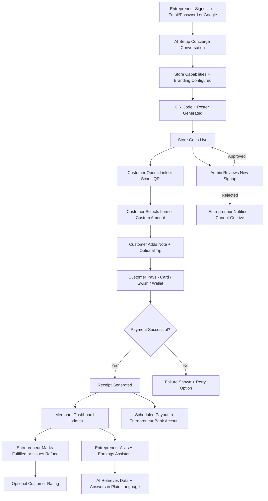
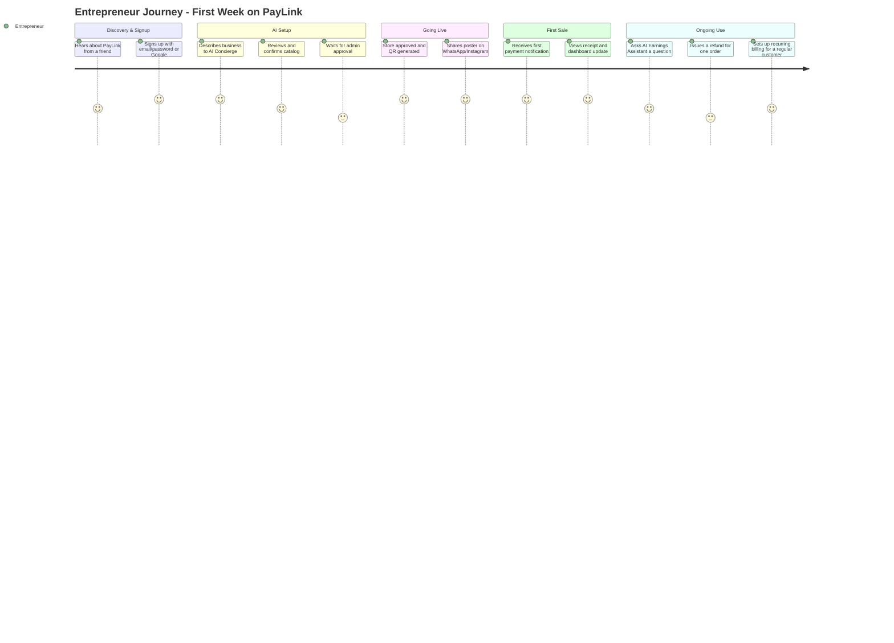
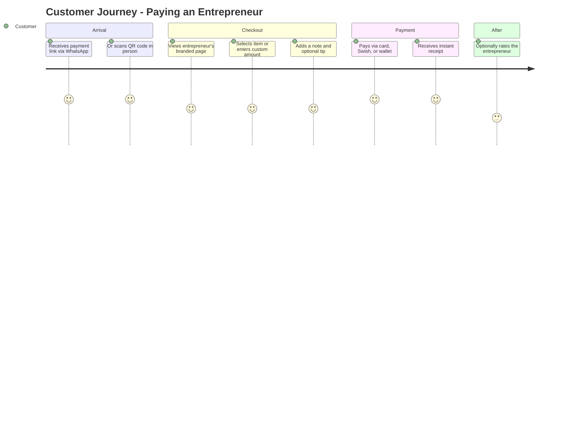
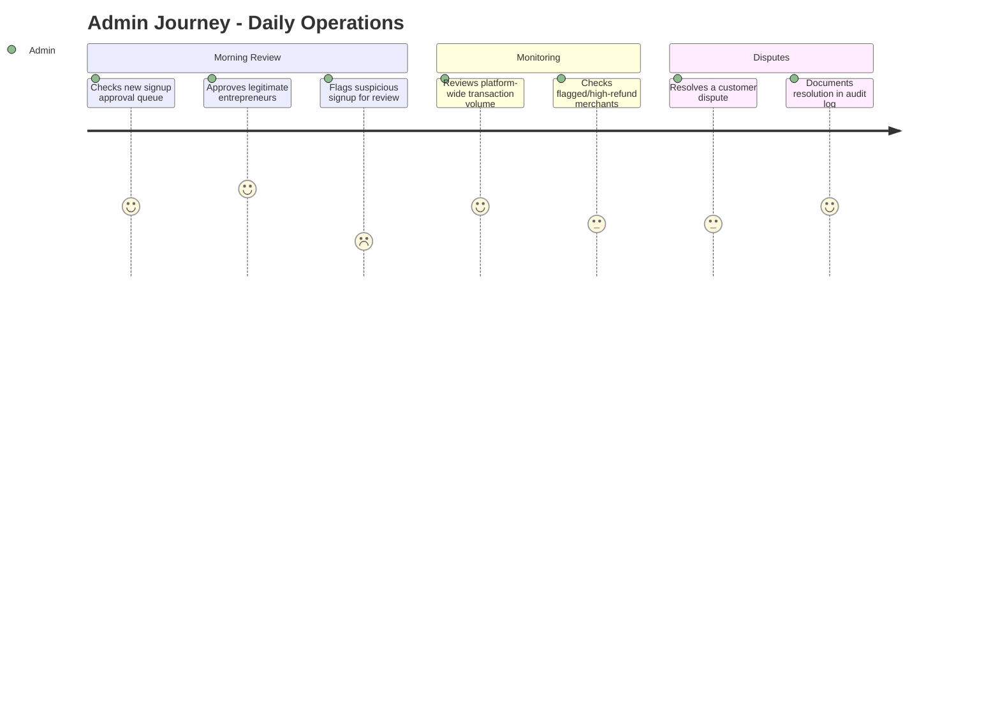
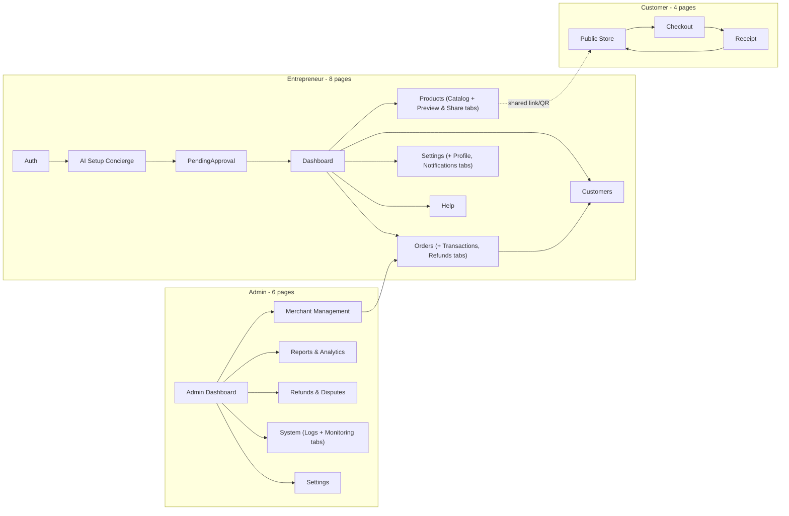
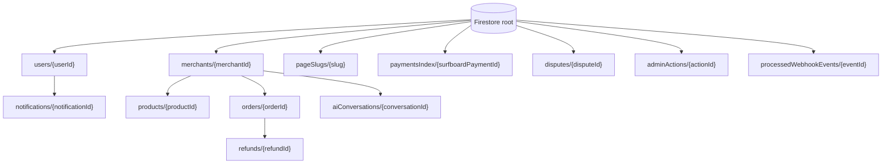
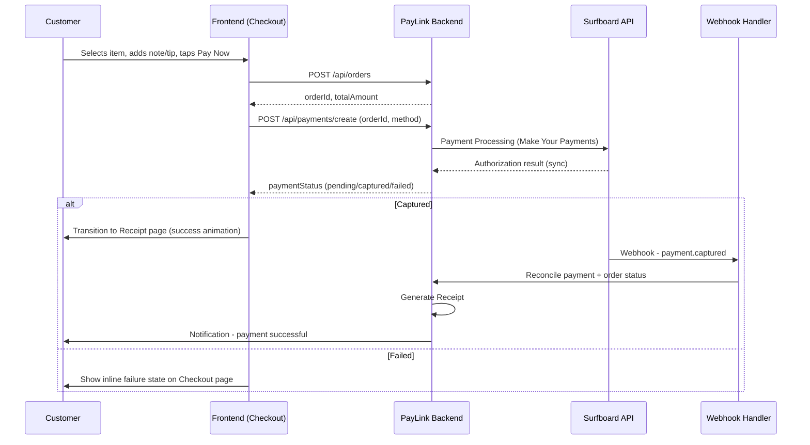
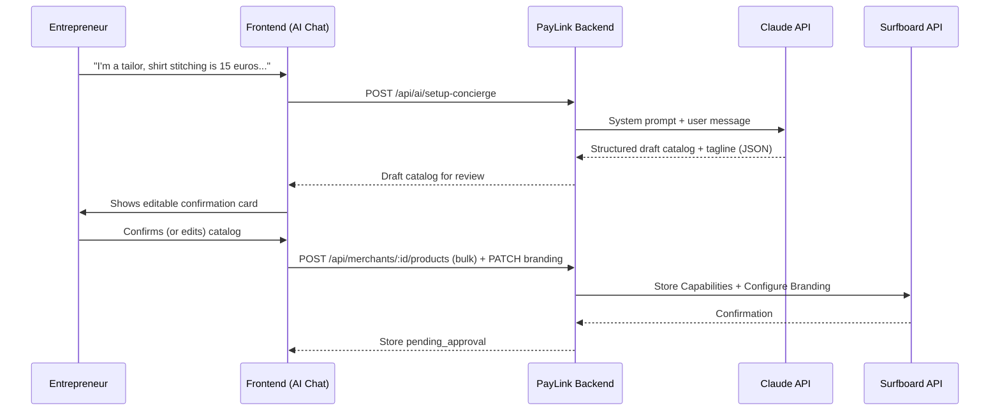
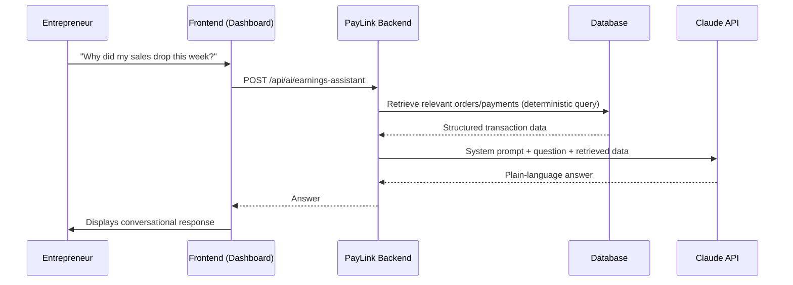

# PayLink — Master Documentation (README.md)

> **Single Source of Truth** for the PayLink platform. This document is written so that a new engineer, designer, or an AI coding assistant (Claude Code, Cursor, GitHub Copilot, etc.) can build the entire product from this file alone, without needing to ask clarifying questions about scope, business rules, data model, or workflows.

**Version:** 1.0
**Status:** Pre-development / Specification Complete
**Market:** Europe (Nordic-first — Sweden, Finland, Norway), built on Surfboard Payments APIs
**Owner:** PayLink Product Team

---

## Table of Contents

1. [Project Introduction](#1-project-introduction)
2. [Problem Statement](#2-problem-statement)
3. [Existing System](#3-existing-system)
4. [Proposed System](#4-proposed-system)
5. [Target Users](#5-target-users)
6. [User Personas](#6-user-personas)
7. [Functional Requirements](#7-functional-requirements)
8. [Non-Functional Requirements](#8-non-functional-requirements)
9. [Complete Feature List](#9-complete-feature-list)
10. [AI Features](#10-ai-features)
11. [Complete System Workflow](#11-complete-system-workflow)
12. [User Journey](#12-user-journey)
13. [Complete Page Documentation](#13-complete-page-documentation)
14. [Entrepreneur Pages](#14-entrepreneur-pages)
15. [Customer Pages](#15-customer-pages)
16. [Admin Pages](#16-admin-pages)
17. [UI Components](#17-ui-components)
18. [Navigation Flow](#18-navigation-flow)
19. [Database Design](#19-database-design)
20. [Backend Architecture](#20-backend-architecture)
21. [Frontend Architecture](#21-frontend-architecture)
22. [API Documentation](#22-api-documentation)
23. [Surfboard API Integration](#23-surfboard-api-integration)
24. [Authentication](#24-authentication)
25. [Payment Flow](#25-payment-flow)
26. [AI Workflow](#26-ai-workflow)
27. [Notifications](#27-notifications)
28. [Security](#28-security)
29. [Error Handling](#29-error-handling)
30. [Business Rules](#30-business-rules)
31. [Folder Structure](#31-folder-structure)
32. [Technology Stack](#32-technology-stack)
33. [Deployment](#33-deployment)
34. [Testing](#34-testing)
35. [Future Roadmap](#35-future-roadmap)
36. [Risks](#36-risks)
37. [Assumptions](#37-assumptions)
38. [FAQs](#38-faqs)
39. [Glossary](#39-glossary)
40. [Developer Guide](#40-developer-guide)
41. [Conclusion](#41-conclusion)

---

## 1. Project Introduction

### Project Name
**PayLink**

### Tagline
*"Your Shop. Your Page. Get Paid — No App, No Approval, No Waiting."*

### Vision
A world where anyone who can describe what they sell — in a single sentence — can start accepting professional digital payments within minutes, regardless of whether they have a registered business, a website, or any technical skill.

### Mission
To remove every technical and administrative barrier between a micro-entrepreneur's skill (baking, tailoring, tutoring, repairing) and their ability to get paid professionally, by combining one verified merchant identity with an AI layer that does the configuration work a human would otherwise have to do manually.

### Why This Project Exists
Across Europe, a huge population of solo and micro-entrepreneurs — home bakers, tailors, private tutors, mobile mechanics, freelance beauty professionals — operate entirely on informal payment rails: personal Swish transfers, PayPal, cash, or ad-hoc bank transfers. They are excluded from "real" merchant payment infrastructure not because they lack customers, but because they lack:

- A registered business entity
- KYB (Know Your Business) documentation
- The technical literacy to configure a payment gateway, catalog, or dashboard

PayLink exists to close that specific gap — not by building "yet another payment gateway," but by becoming the **one verified merchant identity** that thousands of these individuals can operate underneath as sub-merchants, with an AI concierge doing the setup work for them.

### Business Goal
Onboard and retain a large base of micro-entrepreneurs who would otherwise never get a professional payment page, converting a fragmented, informal cash/bank-transfer economy into trackable, digital, receipted transactions — while PayLink earns a small margin on transaction volume.

### Technical Goal
Build a reliable orchestration layer over Surfboard Payments APIs that abstracts away merchant onboarding complexity, wraps it in a conversational AI interface, and exposes a simple, mobile-first web experience for both the entrepreneur and their customers.

### Long-Term Vision
Evolve PayLink from a payment page generator into a **complete micro-business operating layer** — adding inventory, loyalty, invoicing, and an AI business advisor — while keeping the core promise intact: no paperwork, no app installs, no technical skill required.

### Real-World Problem
A home baker in Gothenburg cannot legally or practically register as a full merchant with a traditional acquirer just to sell cakes to neighbors. She resorts to Swish and word-of-mouth. She has no receipts, no analytics, no professional page to point new customers to, and no way to run recurring billing for standing orders.

### Target Industry
Consumer micro-services and micro-retail: food & baking, tailoring/alterations, private tutoring, beauty & wellness, mobile repair services, and informal local retail.

### Project Summary
PayLink is a web platform where any micro-entrepreneur signs up with email/password or Google Sign-In, describes their business in one message to an AI Setup Concierge, and receives a fully configured, brandable payment page with a QR code — all running as a sub-merchant under PayLink's single verified Surfboard merchant identity. Customers pay via card, Swish, or wallet, with receipts, tipping, and optional order notes. Entrepreneurs get a natural-language AI Earnings Assistant instead of a traditional analytics dashboard.

### Project Story
The idea began from observing the exact operational pain of merchants managing multiple stores manually through partner support — configuring branding, tips, and payment methods store by store. That same insight, scaled down, revealed an even larger and more relatable problem: individuals who can't even get *one* store configured because they don't qualify for merchant status in the first place. PayLink is the response to that smaller, more universal version of the problem.

### Unique Selling Proposition (USP)
**"Talk, don't fill forms."** PayLink is the only payment page product in its category where setup is a conversation, not a form — and the only one where an individual with zero paperwork can operate as a fully functioning merchant from day one.

### Value Proposition
| For | Value |
|---|---|
| Micro-entrepreneurs | Real merchant payment acceptance in minutes, zero paperwork, zero technical skill required |
| Customers | A professional, trustworthy way to pay someone who previously only accepted cash or informal transfers |
| PayLink (platform) | Transaction-based revenue across a large base of previously unbanked/unbankable micro-merchants |

---

## 2. Problem Statement

### The Problem in Detail
Digital payment acceptance today assumes a business has already cleared a registration and verification bar. Micro-entrepreneurs — by definition — often haven't and can't, either because their business is too small, too informal, or too new to justify the paperwork. This creates a large population that is economically active but digitally payment-excluded in any *professional* sense.

### Who Faces This Problem
- Home bakers and cooks selling via word-of-mouth or Instagram/WhatsApp
- Tailors and alteration specialists working from home
- Private tutors and language teachers
- Freelance beauty, hair, and wellness professionals
- Mobile mechanics and handymen
- Small market-stall and pop-up retailers

### Why Current Solutions Fail
Existing payment-page products (Zettle, SumUp, Stripe Payment Links) still require the user to complete a merchant account signup with identity verification and bank account linkage — a process that is often too slow, too document-heavy, or simply confusing for a non-technical solo operator. None of them offer a **conversational, zero-form setup**, and none of them solve the underlying "I don't qualify as a registered merchant" blocker directly — they only make the form-filling faster, not optional.

### Business Impact
- Entrepreneurs lose sales from customers unwilling to send informal bank transfers
- No transaction history means no ability to apply for credit, prove income, or track growth
- Word-of-mouth-only businesses cannot scale past their existing personal network
- Local economies retain more cash and off-books activity than necessary

### User Pain Points
- "I don't know how to set up a payment page."
- "I don't have a registered business, so I can't get a real merchant account."
- "My customers don't trust sending money to a personal number for a large order."
- "I have no idea how much I made this month without going through my bank app manually."
- "I don't have time to learn a new dashboard."

### Technical Pain Points
- Merchant onboarding flows are built for registered businesses, not individuals
- Dashboards assume the user already understands business analytics vocabulary
- Multi-item catalogs, custom invoicing, and recurring billing typically require separate manual configuration steps across several settings screens

---

## 3. Existing System

### Explanation of Existing Solutions
Current payment-page products let a registered business generate a shareable link or QR code that a customer can pay directly, without a full e-commerce site. The strongest examples in PayLink's target market (Europe) are:

| Product | Model |
|---|---|
| Zettle by PayPal | POS + payment links for small retail/hospitality businesses |
| SumUp | Card reader hardware + online payment links |
| Stripe Payment Links | Developer-first, no-code payment link generator |
| Klarna | Checkout + "buy now pay later" for e-commerce |

### Advantages of Existing Solutions
- Well-trusted brands with strong security reputations
- Fast card settlement times
- Reasonably simple link/QR generation once onboarded
- Strong developer documentation (Stripe in particular)

### Disadvantages
- Full KYB/merchant verification required before any link can be generated
- No conversational or AI-assisted setup — every field is manually filled
- Analytics are dashboard-based, requiring the user to interpret charts and tables themselves
- Multi-item catalogs and custom invoicing are separate, manually configured features
- None are designed specifically for **individuals without a registered business**

### Limitations
- Onboarding time: typically 1–3 days for verification, sometimes longer
- Requires a business bank account in most cases
- No natural-language interface anywhere in the setup or reporting flow
- Not designed around the "one verified identity, many sub-merchants" model — each user must independently qualify

### Market Competitors
- **Zettle by PayPal** — closest in spirit (payment links + simple dashboard), but full merchant KYB required
- **SumUp** — strong in-person hardware story, weaker on the "zero setup" promise
- **Stripe Payment Links** — most flexible technically, least accessible for non-technical solo users
- **Local players** (e.g., Swish for Business in Sweden) — solve payment but not catalog, receipts, or analytics

### Why This Project Is Different
PayLink does not compete on "faster onboarding" — it removes onboarding entirely for the individual by making them a **sub-merchant** of PayLink's own verified Surfboard identity, and replaces every manual configuration step with a single natural-language conversation with an AI Setup Concierge.

---

## 4. Proposed System

### Complete Explanation
PayLink is a two-sided platform:
1. A **merchant aggregation layer** — PayLink holds one verified Surfboard merchant identity; every entrepreneur who signs up becomes a sub-merchant instantly, with no independent KYB.
2. An **AI orchestration layer** — a conversational AI Setup Concierge configures the entrepreneur's catalog, branding, and payment page from natural language, and an AI Earnings Assistant replaces the traditional analytics dashboard with conversational Q&A.

### How PayLink Solves the Problem
| Problem | PayLink's Solution |
|---|---|
| No registered business / can't pass KYB | Operate as a sub-merchant under PayLink's single verified identity |
| No technical skill to configure a page | AI Setup Concierge builds the page from one message |
| No time to learn a dashboard | AI Earnings Assistant answers questions in plain language |
| Customers don't trust personal transfers | Branded, professional payment page + automatic receipts |
| No recurring billing for repeat customers | Native recurring payment setup, no re-entry required |

### Why It Is Better
- **Zero-form onboarding** — the only product in this category where setup is a conversation
- **No KYB burden on the individual** — the aggregation model removes the single biggest blocker outright
- **AI-native reporting** — answers questions instead of presenting charts a non-technical user must interpret

### Business Advantages
- Large addressable base of previously unbankable micro-merchants
- Sticky product — once an entrepreneur's whole customer base uses their PayLink page, switching cost is high
- Transaction-volume-based revenue model scales naturally with usage

### Technical Advantages
- Thin orchestration layer over a single, well-documented payments API (Surfboard) rather than integrating multiple acquirers
- AI features are additive, not core-path-blocking — the base payment flow works even if AI services are degraded (see [Error Handling](#29-error-handling))
- Clear separation between merchant-facing AI (setup, earnings) and core transaction processing, so AI failures never affect payment reliability

---

## 5. Target Users

### Primary Users — Micro-Entrepreneurs (Sub-Merchants)
Individuals selling goods or services who currently lack a registered business or merchant account: home bakers, tailors, tutors, mobile mechanics, beauty professionals, small stall/pop-up sellers.

### Secondary Users — Customers (Payers)
Anyone paying a specific entrepreneur they already know, via a shared link, WhatsApp/Instagram message, or an in-person QR code. Not a discovery audience — they arrive already knowing who they're paying.

### Admin
The PayLink internal operations team, responsible for approving new entrepreneur signups, monitoring platform-wide transaction volume, and resolving disputes/escalated refunds.

### Platform Owner
The legal entity operating PayLink — holds the single verified Surfboard merchant identity, is the party of record for regulatory/compliance purposes, and earns transaction-based revenue.

### Merchant (Sub-Merchant)
Synonymous with "Primary User" above — used interchangeably with "Entrepreneur" throughout this document and the codebase (`merchants` table).

### Future Users
- **Staff accounts** — entrepreneurs with helpers who need limited dashboard access (Phase 2+)
- **Referral partners** — local business associations or vendors who refer entrepreneurs in exchange for a commission (Phase 3+)
- **Corporate/institutional buyers** — customers who pay multiple entrepreneurs regularly and want a unified payment history (Future roadmap)

---

## 6. User Personas

### Persona 1 — Elin, the Home Baker
- **Age:** 34, Gothenburg, Sweden
- **Goals:** Get paid professionally for custom cake orders without asking customers to Swish her personally
- **Problems:** No registered business; intimidated by "merchant account" terminology; doesn't have time to learn a dashboard
- **Needs:** A page she can share on Instagram, a QR code for local pickup, simple weekly earnings summary
- **Behavior:** Mobile-only user, checks her phone between baking sessions, communicates with customers over WhatsApp

### Persona 2 — Markus, the Mobile Tutor
- **Age:** 27, Helsinki, Finland
- **Goals:** Charge recurring monthly fees to 12 regular students without manually invoicing each one
- **Problems:** Forgets to charge some students some months; no professional-looking way to bill
- **Needs:** Recurring billing setup once per student, automatic reminders on failed charges
- **Behavior:** Comfortable with apps generally, but has zero patience for a multi-step merchant onboarding form

### Persona 3 — Astrid, the Tailor
- **Age:** 51, Oslo, Norway
- **Goals:** Take deposits for custom wedding-dress alterations and collect the balance on completion
- **Problems:** Needs one-off custom invoice amounts, not a fixed price list; skeptical of "yet another app"
- **Needs:** A trustworthy, simple page; someone she can describe her business to in her own words rather than fill out forms
- **Behavior:** Low technical confidence, prefers voice/conversation over typing where possible

### Persona 4 — PayLink Admin — Johan
- **Role:** Operations analyst at PayLink
- **Goals:** Approve legitimate new sub-merchants quickly, catch suspicious signups, resolve disputes fairly
- **Problems:** Needs visibility across thousands of tiny merchants without being overwhelmed by noise
- **Needs:** Clear approval queue, flagged-transaction views, audit trail for every admin action


---

## 7. Functional Requirements

### 7.1 Authentication
- FR-1: User must be able to sign up/log in with email and password via Firebase Authentication
- FR-2: User must be able to sign up/log in with Google Sign-In via Firebase Authentication as an alternative to email/password
- FR-3: System must rate-limit login attempts (max 5 failed attempts per account per hour) to prevent brute-force attacks
- FR-4: Password reset must be available via Firebase Authentication's built-in reset-email flow

### 7.2 Merchant Onboarding
- FR-5: New user must be able to start the AI Setup Concierge conversation immediately after account creation
- FR-6: AI must extract structured catalog data (item name, price, currency) from free-text description
- FR-7: AI must ask a clarifying follow-up question when pricing or item names are ambiguous
- FR-8: System must create a Surfboard sub-merchant record and Store Capabilities configuration upon confirmation
- FR-9: System must auto-generate a QR code linked to the entrepreneur's public page
- FR-10: System must auto-generate a shareable poster image (name, tagline, QR code)

### 7.3 Catalog & Store Management
- FR-11: Entrepreneur must be able to add, edit, and delete catalog items
- FR-12: Entrepreneur must be able to enable "custom amount" invoicing in addition to, or instead of, fixed items
- FR-13: Entrepreneur must be able to toggle store status Open/Closed
- FR-14: Entrepreneur must be able to update branding (photo, tagline, theme color)
- FR-15: Entrepreneur must be able to restrict accepted payment methods per store (e.g., card + Swish only)

### 7.4 Checkout & Payments
- FR-16: Customer must be able to select a catalog item or enter a custom amount
- FR-17: Customer must be able to add an order note (free text, max 200 characters)
- FR-18: Customer must be able to add an optional tip (preset percentages + custom amount)
- FR-19: Customer must be able to pay via card, Swish, or supported wallet
- FR-20: System must generate and display/send a receipt immediately after successful payment
- FR-20a: System must generate a downloadable PDF bill (item, price, merchant name/logo, timestamp) immediately after successful payment, available to both customer and entrepreneur
- FR-21: System must support recurring/subscription billing configured once by the entrepreneur

### 7.5 Order & Refund Management
- FR-22: Entrepreneur must be able to view all orders with status (paid, refunded, cancelled)
- FR-23: Entrepreneur must be able to mark an order fulfilled
- FR-24: Entrepreneur must be able to issue a full or partial refund on any paid order
- FR-25: Customer must receive a notification when a refund is issued

### 7.6 AI Earnings Assistant
- FR-26: Entrepreneur must be able to ask free-text questions about their earnings and receive a natural-language answer
- FR-27: AI must be able to answer at minimum: total earnings (day/week/month), best-selling item, repeat customer count, and week-over-week comparisons
- FR-28: AI must gracefully state when it cannot answer a question with available data, rather than guessing

### 7.7 Ratings
- FR-29: Customer may optionally leave a 1–5 star rating after a completed order
- FR-30: Rating must be displayed only on that entrepreneur's own page (not used for cross-platform discovery/search)

### 7.8 Admin
- FR-31: Admin must be able to view and approve/reject new entrepreneur signups
- FR-32: Admin must be able to view platform-wide transaction volume and per-merchant breakdowns
- FR-33: Admin must be able to view and resolve disputes/escalated refund requests
- FR-34: Every admin action must be logged with admin ID, action type, target, and timestamp

---

## 8. Non-Functional Requirements

| Category | Requirement |
|---|---|
| **Performance** | Public payment page must load in under 2 seconds on 4G mobile connections; checkout submission must complete in under 3 seconds under normal load |
| **Security** | All traffic over TLS 1.2+; secrets never stored in source control; PCI-DSS scope minimized by never handling raw card data directly (delegated to Surfboard) |
| **Scalability** | Backend services must be stateless and horizontally scalable; database must support at least 100,000 sub-merchants and 10M transactions without redesign |
| **Availability** | Target 99.9% uptime for the payment and checkout path; AI features may degrade independently without affecting core payments |
| **Reliability** | Payment status must be reconciled via webhook + polling fallback to avoid silent failures |
| **Accessibility** | Public payment pages must meet WCAG 2.1 AA — sufficient color contrast, screen-reader labels, keyboard navigability |
| **Responsiveness** | All entrepreneur and customer pages must be fully usable on mobile (360px width) up to desktop (1440px+) |
| **Maintainability** | Code organized by feature/domain; shared logic extracted into services; no business logic embedded directly in route handlers |
| **Monitoring** | Real-time dashboards for payment success rate, API latency, AI response latency, and error rate |
| **Logging** | Structured JSON logs for all backend requests, with correlation IDs tracing a request across services (backend → Surfboard → webhook) |

---

## 9. Complete Feature List

### Current Features (MVP)
**Merchant / Entrepreneur**
- Email/password login + Google Sign-In (Firebase Authentication)
- AI Setup Concierge (natural-language onboarding)
- Product catalog management (multi-item + custom invoice)
- Branding configuration (photo, tagline, theme)
- QR code generation
- Auto-generated shareable poster
- Open/Closed status toggle
- Order management (list, fulfil, refund)
- AI Earnings Assistant
- Basic settings (language, payout bank details)

**Customer**
- Public payment page (no login required)
- Item selection or custom amount entry
- Order note field
- Optional tip
- Card / Swish / wallet checkout
- Automatic receipt
- Downloadable PDF bill
- Optional star rating

**Admin**
- Entrepreneur approval queue
- Platform dashboard (volume, growth)
- Dispute/refund escalation handling
- Basic reporting

### Future Features (Roadmap)
- Voice-based AI onboarding
- Multi-language AI assistant (beyond initial language set)
- Inventory tracking
- Customer loyalty programs
- WhatsApp Business integration for order notifications
- Sales forecasting via AI
- AI-generated marketing suggestions ("post this at 6pm on Fridays")

### Optional Features (Nice-to-Have, Not MVP-Blocking)
- Staff/helper sub-accounts under one entrepreneur
- Multiple photos per catalog item
- Custom domain mapping for an entrepreneur's page

### AI Features
- AI Setup Concierge (see [Section 10](#10-ai-features))
- AI Earnings Assistant (see [Section 10](#10-ai-features))

### Payment Features
- One-time payments
- Recurring/subscription payments
- Tipping
- Multi-method support (card, Swish, wallet)
- Refunds (full and partial)
- Automatic receipts
- Downloadable PDF bill

### Merchant Features
See "Merchant / Entrepreneur" above.

### Customer Features
See "Customer" above.

### Admin Features
See "Admin" above.


---

## 10. AI Features

PayLink has exactly two AI modules in the MVP. Both are designed to be **additive** — if either is unavailable, the core payment path continues to function using manual fallback forms.

### 10.1 AI Setup Concierge

**Purpose:** Convert a single free-text business description into a fully configured store (catalog, branding, payment page).

**Trigger:** First-time entrepreneur, immediately after account creation, or re-invoked any time from Settings ("Update my store with AI").

**Prompt Flow:**
1. System prompt establishes the AI's role: *"You are PayLink's setup assistant. Extract a structured store profile from what the entrepreneur tells you. Ask at most one clarifying question at a time. Never invent prices or names that weren't mentioned."*
2. User message: free-text business description (e.g., "I'm a tailor. Shirt stitching is 300, blouse is 500, and sometimes I do custom wedding blouses around 1200.")
3. AI responds with a structured draft (JSON) of catalog items + a suggested tagline, and asks a clarifying question only if something is genuinely ambiguous (e.g., currency not specified, price range instead of fixed price).
4. Entrepreneur confirms or edits inline.
5. On confirmation, backend calls Store Capabilities + Configure Branding APIs, then generates QR + poster.

**System Prompt (representative):**
```
You are PayLink's AI Setup Concierge. Your job is to turn a merchant's
free-text description of their business into a structured store profile.

Rules:
- Only use information the merchant actually provided. Never invent prices,
  item names, or business details.
- If a price or currency is ambiguous, ask ONE clarifying question before
  proceeding — do not guess.
- Support both fixed-price catalog items and "custom amount" items
  (e.g., "custom wedding blouse — price varies").
- Output a JSON object: { businessName, tagline, items: [{name, price,
  currency, isCustom}], clarifyingQuestion (nullable) }.
- Keep the tagline under 10 words, friendly, and specific to the business
  described — never generic.
```

**Context:** The current conversation only (no long-term memory across sessions in MVP — each setup session is stateless once the store is created).

**Function Calling:** The AI does not call Surfboard APIs directly. It returns structured JSON; the PayLink backend performs the actual API calls after the entrepreneur confirms, keeping payment-affecting actions under explicit human confirmation at all times.

**Business Logic Applied After AI Output:**
- Prices are validated as positive numbers before being sent to Store Capabilities
- Tagline is checked against a profanity/length filter
- If the AI's clarifying question goes unanswered for more than 2 minutes, the UI falls back to a simple manual form pre-filled with whatever the AI did understand

**Fallback:** If the AI service is unavailable or returns malformed output, the entrepreneur is seamlessly routed to a manual "Add your first item" form — the AI is a convenience layer, never a hard dependency for onboarding.

### 10.2 AI Earnings Assistant

**Purpose:** Replace a traditional analytics dashboard with conversational Q&A over the entrepreneur's own transaction history.

**Trigger:** Entrepreneur types or taps a suggested question in the Dashboard's AI chat box.

**Prompt Flow:**
1. System prompt establishes scope: *"You are PayLink's Earnings Assistant. Answer only using the transaction data provided in context. Never estimate or guess numbers you were not given."*
2. Backend performs a **pre-retrieval step**: based on the question, it queries the `orders`/`payments` tables for the relevant date range and metrics (this is deterministic backend logic, not left to the AI to "remember" or infer).
3. Retrieved data is passed to the AI as structured context alongside the entrepreneur's question.
4. AI produces a plain-language answer, citing the specific numbers retrieved.

**System Prompt (representative):**
```
You are PayLink's AI Earnings Assistant for [Merchant Name].
You will be given: (1) the merchant's question, and (2) a JSON object
of relevant transaction data already retrieved for you.

Rules:
- Only use the numbers provided in the JSON context. Never estimate or
  fabricate a figure.
- If the provided data does not answer the question, say so plainly and
  suggest what date range or detail would help.
- Keep answers short, plain-language, and specific (cite the actual
  number, not just a description).
```

**Memory:** No persistent cross-session memory in MVP; each question is answered fresh from freshly retrieved data, to avoid the AI ever "remembering" a stale or incorrect figure.

**Function Calling:** The backend, not the AI, decides which Firestore queries to run based on lightweight intent classification of the question (e.g., "this week" → a `where('createdAt', '>=', ...)` range filter on the merchant's `orders` subcollection; "best-selling" → an aggregation pass over the same result set, computed in application code since Firestore has no `GROUP BY`).

**Business Logic:** Currency formatting, timezone normalization (all times shown in the entrepreneur's local timezone), and rounding are all applied by the backend before numbers ever reach the AI, so the AI is never responsible for arithmetic correctness — only for phrasing.

**Output:** A short conversational answer, optionally with a simple inline sparkline/number highlight in the UI (not a full chart).

**Fallback:** If retrieval fails or returns empty data, the AI responds with a clear "I don't have enough data to answer that yet" rather than a fabricated answer, and the UI offers a link to the raw Orders table as a manual fallback.


---

## 11. Complete System Workflow

### 11.1 High-Level Workflow (Mermaid Flowchart)



### 11.2 Step-by-Step Narrative

**Signup**
1. Entrepreneur signs up with email + password, or taps "Continue with Google" — both handled directly by the Firebase Authentication client SDK.
2. Firebase issues an ID token to the frontend automatically; no custom OTP/SMS step and no custom session-token system involved.
3. On first sign-in, the backend verifies the Firebase ID token (Section 24) and creates the corresponding `merchants` document keyed on the Firebase Auth UID.

**Merchant / Sub-Merchant Creation**
4. Backend calls Surfboard **Multi Merchant Groups** API to create a new sub-merchant record under PayLink's single verified identity.
5. New entrepreneur record created in `merchants` table, status = `pending_setup`.

**Store Setup (AI-Assisted)**
6. Entrepreneur describes their business to the AI Setup Concierge.
7. AI returns structured catalog + tagline draft.
8. Entrepreneur confirms (or edits).
9. Backend calls **Store Capabilities** (catalog, custom-amount toggle) and **Configure Branding** (photo, tagline, theme) APIs.
10. Merchant status updated to `pending_approval`.

**Admin Approval**
11. Admin reviews the new sub-merchant in the approval queue.
12. Admin approves → status becomes `active`; or rejects → entrepreneur notified with a reason.

**QR Generation**
13. On approval, backend generates a unique public page URL and a corresponding QR code image.
14. Shareable poster (name, tagline, QR) auto-generated as a downloadable image.

**Payments**
15. Customer opens the public page (no login required).
16. Customer selects a catalog item or enters a custom amount, adds an optional note and tip.
17. Backend calls **Payment Processing** (Make Your Payments) with selected **Payment Methods**.
18. Surfboard processes the payment and returns a result synchronously, confirmed asynchronously via webhook.

**Refund**
19. Entrepreneur selects an order and requests a refund (full or partial).
20. Backend calls **Refund Operations**; Surfboard processes the reversal.
21. Customer notified of the refund.

**Receipt & Bill**
22. On successful payment (and again on refund), backend calls the **Receipts** API to generate a proof-of-transaction reference, and separately renders a downloadable PDF bill (item, price, merchant name/logo, timestamp) from the order data — both shown in-browser and available for download/email.

**Dashboard / Analytics**
23. Every payment event updates the entrepreneur's dashboard in near-real-time (earnings totals, order list).
24. Entrepreneur may ask the AI Earnings Assistant a free-text question at any time.

**Settlement**
25. PayLink holds a brief settlement reserve per Surfboard's standard settlement schedule, then transfers the remaining balance to the entrepreneur's linked bank account on the configured payout cycle.

**Notifications**
26. SMS/email/in-app notifications fire on: successful payment, refund issued, recurring charge upcoming, recurring charge failed, admin approval/rejection.

**Admin**
27. Admin can view platform-wide volume, individual merchant activity, and resolve disputes at any point independent of the above flow.


---

## 12. User Journey

### 12.1 Merchant Journey (Mermaid Journey Diagram)



### 12.2 Customer Journey (Mermaid Journey Diagram)



### 12.3 Admin Journey (Mermaid Journey Diagram)




---

## 13. Complete Page Documentation

> **Consolidated structure:** PayLink is organized into **18 pages** (8 Entrepreneur, 4 Customer, 6 Admin) — down from an earlier 36-page draft that counted several tabs and UI elements as if they were separate destinations. Related views are now grouped as **tabs within one page** rather than separate screens, and two things that were never really "pages" (the AI chat button and the notification bell) are documented in Section 17 as persistent UI elements instead. Nothing was removed — every capability from the earlier draft still exists, it's just organized the way a user would actually navigate it.

Every page below uses the same template so a developer or AI assistant can build any page in isolation without needing surrounding context:

| Field | What It Covers |
|---|---|
| **Purpose** | Why this page exists, in one sentence |
| **Tabs** | If the page has more than one view, what they are |
| **Layout & Components** | The concrete UI elements on the page — cards, buttons, inputs, tables, charts |
| **Validation & Business Logic** | What must be true before an action succeeds; what the backend enforces |
| **API Calls** | Which backend endpoints (Section 22) this page calls, and when |
| **Navigation** | Where the user can go to/from this page |
| **States** | Loading, empty, success, and failure presentations |
| **Permissions** | Who can access this page and under what session/role conditions |
| **Future Improvements** | Known, deliberately deferred enhancements |

---

## 14. Entrepreneur Pages (8)

### 14.1 Auth
*(Merges the former Signup, Login, and OTP Verification screens — one flow, not three destinations. Login method changed from phone OTP to Firebase email/password + Google Sign-In after Twilio reliability issues during development — see Section 36, Risks.)*
- **Purpose:** Get a new or returning entrepreneur from "I have an email or Google account" to a valid session.
- **Layout & Components:** Email + password fields with "Sign Up" / "Log In" toggle, a "Continue with Google" button (Firebase's `signInWithPopup` + `GoogleAuthProvider`), and a "Forgot password?" link. Copy changes based on whether the account is recognized, but it's the same screen underneath.
- **Validation & Business Logic:** Email must be valid format; password minimum 8 characters, enforced client-side before submission and again by Firebase Authentication server-side. Account creation, login, Google Sign-In, and password reset are all handled directly by the Firebase Authentication client SDK — the frontend does not send credentials to PayLink's own backend at all.
- **API Calls:** None for authentication itself (handled entirely by the Firebase Auth SDK). On first sign-in only, the frontend calls `POST /api/auth/session` so the backend can verify the new Firebase ID token and create the corresponding `merchants` document.
- **Navigation:** → AI Setup Concierge (first-time users) or → Dashboard (returning users).
- **States:** Loading spinner while Firebase processes sign-up/login/Google popup; inline field-level error (e.g., "wrong password", "email already in use") sourced from Firebase Auth's own error codes.
- **Permissions:** Public, unauthenticated (pre-session).
- **Future Improvements:** "Remember this device" longer-lived sessions; additional social providers (Apple, Facebook) if requested by users.

### 14.2 AI Setup Concierge
- **Purpose:** Configure the entrepreneur's entire store from a natural-language conversation.
- **Layout & Components:** Chat interface (message bubbles), typing indicator, inline "confirm catalog" card summarizing extracted items with edit icons, "Confirm & Publish" button.
- **Validation & Business Logic:** All prices validated as positive numbers in a supported currency before submission; profanity/length filter on tagline; at least one catalog item or the custom-amount toggle must be enabled before publishing is allowed.
- **API Calls:** `POST /api/ai/setup-concierge`, then on confirmation → `POST /api/merchants/:id/products` (bulk), `PATCH /api/merchants/:id` (branding).
- **Navigation:** → Admin approval pending screen → Dashboard once approved.
- **States:** Typing/loading indicator while AI responds; failure state falls back to a manual "Add Item" form on the Products page; empty state shown if the entrepreneur skips straight to manual entry.
- **Permissions:** Authenticated entrepreneur only.
- **Future Improvements:** Voice input for the initial business description.

### 14.3 Dashboard
*(Merges the former Dashboard and Analytics pages — the AI Earnings Assistant lives here, not on a separate "Analytics" destination.)*
- **Purpose:** The entrepreneur's home screen — earnings snapshot, recent orders, and the AI Earnings Assistant, all in one place.
- **Layout & Components:** Summary cards (Today / This Week / This Month earnings), recent-orders list, Open/Closed toggle in the header, and an AI chat box for earnings questions with quick-question chips ("This week", "Best seller", "Repeat customers") plus minimal supporting sparkline visuals.
- **Validation & Business Logic:** Summary figures always reflect the entrepreneur's local timezone; Open/Closed toggle takes effect immediately platform-wide; all AI-facing figures are computed server-side (Section 10.2) before the AI ever sees them.
- **API Calls:** `GET /api/merchants/:id/summary`, `PATCH /api/merchants/:id/status`, `POST /api/ai/earnings-assistant`
- **Navigation:** → Orders, → Products, → Settings (via nav bar).
- **States:** Skeleton loaders on cards while fetching; empty state ("No sales yet — share your page!") for brand-new stores; typing indicator while the AI composes an earnings answer.
- **Permissions:** Authenticated entrepreneur only, own data.
- **Future Improvements:** Customizable dashboard widgets; exportable weekly email summary generated by the same AI.

### 14.4 Orders
*(Merges the former Orders, Transactions, and Refunds pages as tabs on one page — same underlying data, three views of it.)*
- **Purpose:** Everything related to what's been sold, paid, and refunded.
- **Tabs:** **Orders** (fulfillment-focused list) · **Transactions** (raw financial ledger — every payment, refund, and payout event with Surfboard reference IDs) · **Refunds** (searchable order list with full/partial refund actions and refund status history)
- **Layout & Components:** Filterable/sortable table (date, customer note, amount, status), row-level "Refund" and "Mark Fulfilled" actions on the Orders tab; read-only ledger with export/download on the Transactions tab; refund amount input with remaining-balance validation on the Refunds tab.
- **Validation & Business Logic:** Refund action only enabled on `paid` orders; partial refund amount cannot exceed the remaining refundable balance; refunds beyond Surfboard's allowed window are blocked with an explanatory message.
- **API Calls:** `GET /api/merchants/:id/orders`, `GET /api/merchants/:id/transactions`, `POST /api/payments/:id/refund`, `PATCH /api/orders/:id/fulfil`
- **Navigation:** → Order detail/receipt view (from any tab).
- **States:** Loading skeleton rows; empty state for stores with no orders yet; failure state with retry.
- **Permissions:** Authenticated entrepreneur only, own orders.
- **Future Improvements:** Bulk actions (fulfil multiple orders at once); CSV/PDF export for accounting; reason-code tagging for refunds.

### 14.5 Products
*(Merges the former Products, QR & Poster, and Payment Page Preview pages as tabs — all "manage and share my store.")*
- **Purpose:** Configure the catalog and share the store.
- **Tabs:** **Catalog** (add/edit/remove items, custom-amount toggle) · **Preview & Share** (live read-only render of the public page, QR code, poster download)
- **Layout & Components:** Item list with inline edit and "Add Item" modal (name, price, currency, custom-amount toggle, optional product image) on the Catalog tab; read-only public-page preview, "Copy Link" button, QR preview, and "Download Poster" button on the Preview & Share tab.
- **Validation & Business Logic:** Price must be a positive number; item name required, max 60 characters; at least one item or custom-amount mode must remain enabled; product images compressed client-side (Section 19.2). QR and poster are generated **entirely client-side** (Section 21.8) — no backend call, no Storage cost.
- **API Calls:** `POST/PATCH/DELETE /api/merchants/:id/products`, `GET /api/merchants/:slug/public-page` (for the preview)
- **Navigation:** Catalog changes reflect immediately on the Preview & Share tab.
- **States:** Loading list skeleton; empty state prompts AI Concierge re-entry; failure state on save with inline error.
- **Permissions:** Authenticated entrepreneur only, own catalog.
- **Future Improvements:** Multiple photos per item, categories/tags; multiple poster templates/themes.

### 14.6 Customers
- **Purpose:** Lightweight view of repeat customers (by phone/email hash, not full discovery/CRM).
- **Layout & Components:** List of customers with order count and total spent — no full contact management, by design (Section 19.5, Privacy).
- **Validation & Business Logic:** Only customers who've transacted at least twice are surfaced as "repeat"; single-purchase customers are not individually tracked in this view.
- **API Calls:** `GET /api/merchants/:id/customers`
- **Navigation:** → Orders (filtered by that customer).
- **States:** Loading skeleton; empty state ("No repeat customers yet"); failure with retry.
- **Permissions:** Authenticated entrepreneur only, own data.
- **Future Improvements:** Optional customer notes field for the entrepreneur's own reference.

### 14.7 Settings
*(Merges the former Settings, Profile, and Notifications pages as tabs — all "manage my own account.")*
- **Purpose:** Everything about the entrepreneur's own account, identity, and preferences in one place.
- **Tabs:** **Profile & Business** (photo, logo, business name, category, tagline) · **Payout & Language** (bank details, language toggle) · **Notifications** (in-app notification history and channel preferences)
- **Layout & Components:** Profile/logo upload with client-side compression (Section 19.2) and business fields on the Profile & Business tab; bank account fields and language selector on the Payout & Language tab; reverse-chronological notification list with read/unread indicators on the Notifications tab.
- **Validation & Business Logic:** Business name required, max 80 characters; bank account details validated against the format expected by the entrepreneur's country; notifications older than 90 days are archived, not deleted.
- **API Calls:** `PATCH /api/merchants/:id/profile`, `PATCH /api/merchants/:id/settings`, `GET /api/merchants/:id/notifications`, `PATCH /api/notifications/:id/read`
- **Navigation:** Accessible from the main nav on every entrepreneur page.
- **States:** Per-tab save confirmation toast; upload progress indicator; failure state with field-level error highlighting.
- **Permissions:** Authenticated entrepreneur only, own account.
- **Future Improvements:** Two-factor authentication toggle; push notification preference granularity per event type; multiple team-member profile support (Phase 2).

### 14.8 Help
- **Purpose:** Self-serve support — FAQs, contact options, and basic troubleshooting.
- **Layout & Components:** Searchable FAQ accordion, "Contact Support" button, status page link.
- **Validation & Business Logic:** None (static/informational content, occasionally augmented by the AI chat for common questions).
- **API Calls:** `GET /api/help/articles`
- **Navigation:** Accessible from main nav on every entrepreneur page.
- **States:** Loading skeleton for articles; empty/search-no-results state.
- **Permissions:** Authenticated entrepreneur (a public-facing Support page also exists for customers — Section 15.4).
- **Future Improvements:** In-context help tooltips throughout the rest of the product.

> **Persistent UI elements, not pages:** the **AI chat floating action button** (available on every Entrepreneur screen, routing to the AI Setup Concierge or Dashboard's earnings AI depending on store lifecycle stage) and the **notification bell** (a shortcut into the Settings → Notifications tab) are documented as components in Section 17.7, not as separate pages — this is exactly the over-counting the 36-page draft made.

---

## 15. Customer Pages (4)

### 15.1 Public Store
*(Merges the former Landing Page, Public Store, and item/amount-selection screens — all pre-checkout browsing on one page.)*
- **Purpose:** The branded page a specific entrepreneur shares — the entry point for nearly all customer traffic. A generic PayLink landing (for the rare visitor who arrives without a specific link) is simply this same page's empty/no-slug state, not a separate destination.
- **Layout & Components:** Business photo, name, tagline, catalog item grid or custom-amount field with quantity stepper, Open/Closed banner if the store is currently closed.
- **Validation & Business Logic:** If store status is `Closed`, checkout is disabled and a "not currently taking orders" message is shown instead; custom amount must be within the entrepreneur's configured min/max bounds if set.
- **API Calls:** `GET /api/merchants/:slug/public-page`
- **Navigation:** → Checkout.
- **States:** Loading skeleton; closed-state banner; failure state (invalid/removed link) shown as a friendly 404-style message.
- **Permissions:** Fully public, no login required.
- **Future Improvements:** Store-level announcement banner (e.g., "Taking orders for Friday only"); multi-item cart support (currently single-item-or-amount per transaction).

### 15.2 Checkout
*(Includes the former Failed Payment screen as an in-page error state, not a separate destination.)*
- **Purpose:** Collect note, tip, and payment method, submit payment, and handle failure without leaving the flow.
- **Layout & Components:** Order summary card, note text field, tip selector (preset % + custom), payment method tabs (Card / Swish / Wallet), "Pay Now" button. On failure: failure icon, plain-language reason, "Try Again" action, alternate payment method suggestion — shown in place, not as a redirect.
- **Validation & Business Logic:** Note capped at 200 characters; tip must be zero or positive; payment method must be one the entrepreneur has enabled; failures are distinguished between customer-fixable (declined card — offer retry) and system-level (provider unavailable — "try again shortly").
- **API Calls:** `POST /api/orders`, `POST /api/payments/create`
- **Navigation:** → Receipt on success; stays on Checkout (with the failure state shown) on failure; → Public Store if the customer abandons.
- **States:** Loading spinner on "Pay Now" during processing; disabled state if required fields are incomplete; inline failure state as described above.
- **Permissions:** Fully public.
- **Future Improvements:** Saved payment method for returning customers of the same entrepreneur (with explicit consent); automatic alternate-method suggestion based on the specific decline reason code.

### 15.3 Receipt
*(Merges the former Success and Receipt & Bill screens, with Rating folded in as an optional prompt on the same page rather than a fourth destination.)*
- **Purpose:** Confirm the payment succeeded, provide the downloadable PDF bill, and optionally collect a rating — one continuous moment, not three separate pages.
- **Layout & Components:** Brief success checkmark animation on arrival, then order details (item/amount, tip, note), entrepreneur name, timestamp, "Download Bill (PDF)" button, and an optional 1–5 star rating prompt with a "Skip" option.
- **Validation & Business Logic:** The receipt reference and PDF bill are generated exactly once per successful payment and are immutable thereafter (a refund generates a separate linked document, not an edit to the original); one rating per order, visible only on that entrepreneur's own page, never used for cross-platform discovery.
- **API Calls:** `GET /api/orders/:id/receipt`, `GET /api/orders/:id/bill-pdf` (client-side PDF generation, Section 21.8), `POST /api/orders/:id/rating`
- **Navigation:** Closes back to Public Store, or the customer simply leaves.
- **States:** Brief success-animation transition on load; loading briefly while the receipt/PDF renders; failure state with a "contact support" link if generation fails; rating submission confirmation toast.
- **Permissions:** Accessible via the unique order link (no login required, but not discoverable/guessable).
- **Future Improvements:** Emailed/SMS copy of the PDF bill sent automatically; entrepreneur reply/thank-you note visible back to the customer.

### 15.4 Support
- **Purpose:** Customer-facing help for payment issues.
- **Layout & Components:** Short FAQ ("Is my payment secure?", "I was charged incorrectly"), "Contact PayLink Support" option.
- **Validation & Business Logic:** None — informational, with an escalation path into the Admin Disputes tab (Section 16.4) if a customer submits a complaint.
- **API Calls:** `POST /api/disputes` (if a customer files a complaint)
- **Navigation:** Accessible from the footer of every customer-facing page.
- **States:** Standard form submission loading/success/failure states.
- **Permissions:** Fully public.
- **Future Improvements:** Live chat escalation for high-value disputed transactions.

---

## 16. Admin Pages (6)

### 16.1 Dashboard
- **Purpose:** Platform-wide health snapshot for the operations team.
- **Layout & Components:** Summary cards (total active merchants, total volume, pending approvals, open disputes), trend chart (volume over time).
- **Validation & Business Logic:** All figures aggregate across every sub-merchant in real time via collection group queries (Section 19.4).
- **API Calls:** `GET /api/admin/summary`
- **Navigation:** → Merchant Management, → Reports & Analytics, → Refunds & Disputes.
- **States:** Loading skeleton on cards; failure state with retry.
- **Permissions:** Admin role only.
- **Future Improvements:** Configurable alert thresholds (e.g., notify if refund rate spikes platform-wide).

### 16.2 Merchant Management
- **Purpose:** Approve, reject, suspend, or reactivate sub-merchant accounts.
- **Layout & Components:** Filterable merchant table (status, signup date, category), approval queue tab, per-merchant detail drawer.
- **Validation & Business Logic:** Rejection requires a reason (shown to the entrepreneur); suspension requires an internal note (admin-only).
- **API Calls:** `GET /api/admin/merchants`, `POST /api/admin/merchants/:id/approve`, `POST /api/admin/merchants/:id/reject`, `POST /api/admin/merchants/:id/suspend`
- **Navigation:** → Merchant detail drawer, → that merchant's Orders/Transactions (read-only, admin view).
- **States:** Loading table skeleton; empty state ("No pending approvals"); failure with retry.
- **Permissions:** Admin role only.
- **Future Improvements:** Bulk approval for low-risk categories.

### 16.3 Reports & Analytics
*(Merges the former Reports and Analytics pages — same underlying data, different depth, not two destinations.)*
- **Purpose:** Platform-wide and segment-level reporting, from a quick summary table up to deeper cohort/trend analysis.
- **Tabs:** **Reports** (filterable summary tables, export) · **Analytics** (chart library, segment filters, cohort table)
- **Layout & Components:** Filter controls (date range, category, region) shared across both tabs; export button on Reports; line/bar charts on Analytics.
- **Validation & Business Logic:** Read-only aggregation; no write actions on this page.
- **API Calls:** `GET /api/admin/reports`, `GET /api/admin/analytics`
- **Navigation:** Standalone; no forward navigation beyond export.
- **States:** Loading, empty (no data in selected range), failure with retry.
- **Permissions:** Admin role only.
- **Future Improvements:** Scheduled recurring report emails; predictive churn flagging for at-risk merchants.

### 16.4 Refunds & Disputes
*(Merges the former Refunds admin view and Disputes page — related enough to share one page.)*
- **Purpose:** Platform-wide visibility into refunds for pattern detection, plus resolution of escalated customer complaints.
- **Tabs:** **Refunds** (table of all refunds across all merchants, filterable, flags merchants exceeding a configurable refund-rate threshold) · **Disputes** (queue by status: open/investigating/resolved, detail view with linked order/transaction, resolution notes field)
- **Validation & Business Logic:** Refunds tab is read-only; every dispute resolution action requires a note, and resolved disputes are locked from further edits (audit integrity).
- **API Calls:** `GET /api/admin/refunds`, `GET /api/admin/disputes`, `POST /api/admin/disputes/:id/resolve`
- **Navigation:** → Merchant detail (if a specific merchant is flagged on the Refunds tab), → linked Order/Transaction (from a dispute).
- **States:** Loading skeleton; empty state ("No open disputes" / no flagged merchants); failure with retry.
- **Permissions:** Admin role only.
- **Future Improvements:** Automatic temporary payout hold for merchants far outside normal refund-rate bounds, pending review; SLA timers on open disputes.

### 16.5 System
*(Merges the former Logs and Monitoring pages — both "system health," not two destinations.)*
- **Purpose:** Full audit trail of admin actions, plus real-time technical health of the platform.
- **Tabs:** **Logs** (searchable/filterable append-only audit table — admin ID, action type, target entity, timestamp) · **Monitoring** (live-updating metric tiles for API latency, payment success rate, AI response times, error rates, per Section 8's Non-Functional Requirements)
- **Validation & Business Logic:** Logs are append-only — can never be edited or deleted, even by a senior admin, enforced by a Firestore Security Rule (Section 19.3). Monitoring is read-only.
- **API Calls:** `GET /api/admin/logs`, `GET /api/admin/monitoring`
- **Navigation:** → The specific merchant/order/dispute referenced by a given log entry.
- **States:** Loading, empty (unlikely in practice for Logs), degraded-data warning on Monitoring if a metrics source is stale, failure with retry.
- **Permissions:** Admin role only (viewing other admins' log entries may require a senior-admin permission level, depending on final role design).
- **Future Improvements:** Exportable compliance-ready audit reports; in-app incident timeline with automatic postmortem note-taking.

### 16.6 Settings (Admin/Platform)
- **Purpose:** Platform-level configuration: supported currencies, approval-queue rules, fee/margin configuration, feature flags.
- **Layout & Components:** Grouped configuration sections, each with its own save action and a secondary confirmation dialog for high-impact changes (e.g., changing platform fee percentage).
- **Validation & Business Logic:** High-impact changes require a secondary confirmation step and are logged with extra detail in the audit trail (Section 16.5).
- **API Calls:** `GET/PATCH /api/admin/platform-settings`
- **Navigation:** Standalone.
- **States:** Save confirmation toast; failure state with field-level error.
- **Permissions:** Restricted to a senior-admin role, distinct from general Admin.
- **Future Improvements:** Staged/scheduled configuration rollouts (e.g., "apply new fee structure starting next month").

---

## 17. UI Components & Visual Design System

> PayLink's visual bar is set against Stripe, Linear, Revolut, Vercel, and Notion — restrained, motion-rich but never gratuitous, and consistent enough that a new screen feels like it was always part of the product rather than bolted on.

### 17.0 Design Philosophy
- **Restraint over decoration** — glassmorphism, gradients, and particles are accents on a small number of surfaces, not the default treatment for every card.
- **Motion with purpose** — every animation either confirms an action (payment success), orients the user (page/route transitions), or communicates state (loading, empty, error). Motion that doesn't do one of those three things is cut.
- **One visual owner per effect** — Framer Motion, GSAP, and Lottie each own a distinct category of motion (Section 17.5) rather than being mixed arbitrarily on the same element.
- **Numbers are sacred** — this is a payments product; monetary figures always render in a tabular/mono numeral style so digits align in tables and dashboards, and are never subject to playful animation that could momentarily show an incorrect-looking value.

### 17.1 Design Tokens — Color

| Token | Light mode | Dark mode | Usage |
|---|---|---|---|
| `--color-primary` | `#2563EB` | `#3B82F6` | Primary actions, links, active nav state |
| `--color-secondary` | `#10B981` | `#34D399` | Success states, positive earnings deltas, "paid" status |
| `--color-accent` | `#60A5FA` | `#60A5FA` | Highlights, focus rings, chart accents, gradient stops |
| `--color-bg` | `#F8FAFC` | `#0B1120` | Page background |
| `--color-surface` | `#FFFFFF` | `#111827` | Cards, panels, modals |
| `--color-text-primary` | `#0F172A` | `#F1F5F9` | Headings, body text |
| `--color-text-secondary` | `#475569` | `#94A3B8` | Secondary/muted text |
| `--color-border` | `#E2E8F0` | `#1E293B` | Hairline dividers, card borders |
| `--color-danger` | `#DC2626` | `#F87171` | Failed payments, destructive actions |
| `--color-warning` | `#D97706` | `#FBBF24` | Pending/attention states |

**⚠ Design token note — read before implementing buttons:** `#10B981` (Secondary) and `#60A5FA` (Accent) do **not** reliably pass WCAG AA contrast with white text at normal weight/size — both are mid-brightness colors that were likely chosen for their look on a white card, not as solid button fills. Two safe patterns instead of guessing per-button:
- **Secondary/Accent as a solid fill:** use dark text (`--color-text-primary`) on top, not white.
- **Secondary/Accent as text or an icon:** fine on `--color-bg`/`--color-surface`, since that direction has ample contrast.
- **If a solid emerald/blue CTA with white text is a hard brand requirement:** use a darkened working color for that fill only (e.g., `#047857` for emerald, `#1D4ED8` for blue) — never the literal token value — and keep `#10B981`/`#60A5FA` for everything else. Verify any new pairing with a contrast checker before shipping; don't assume.

### 17.2 Typography
- **Primary typeface:** Inter (variable font) — matches the Stripe/Vercel/Linear register, ships as a system-adjacent font so it loads fast and renders consistently cross-platform.
- **Numeric typeface:** Inter's tabular figure variant (`font-variant-numeric: tabular-nums`) for all monetary amounts, dashboard stats, and table columns — non-negotiable for a payments product, since proportional digits make earnings figures visually "jump" as they update.

| Style | Size | Weight | Line height |
|---|---|---|---|
| Display | 40px | 600 | 1.15 |
| H1 | 32px | 600 | 1.2 |
| H2 | 24px | 600 | 1.25 |
| H3 | 18px | 500 | 1.3 |
| Body L | 16px | 400 | 1.6 |
| Body M | 14px | 400 | 1.6 |
| Caption | 12px | 400 | 1.5 |
| Mono/Numeric | 14–32px (contextual) | 500 | 1.2 |

### 17.3 Spacing, Grid & Radius
- **Base unit:** 4px; spacing scale 4/8/12/16/24/32/48/64.
- **Grid:** 12-column responsive grid, 24px gutters desktop / 16px mobile; content max-width 1280px on wide desktop, full-bleed sidebar layouts for Entrepreneur/Admin.
- **Radius scale:** 6px (inputs, small buttons), 10px (buttons, chips), 16px (cards), 24px (modals, command palette, bottom sheets on mobile).
- **Elevation:** three shadow levels only — resting card (subtle), hovered/raised card (medium), modal/overlay (strong) — no per-component bespoke shadows.

### 17.4 Light Mode, Dark Mode & Theme Toggle
- All color usage flows through the tokens in 17.1 as CSS variables — no component ever hardcodes a hex value, which is what makes dark mode a token swap rather than a second design pass.
- **Default:** respects the OS-level `prefers-color-scheme` on first visit; the user's explicit choice afterward is persisted and takes priority over the OS setting.
- **Toggle interaction:** a single icon control (sun/moon) that cross-fades and rotates 180° between icon states over ~300ms (Framer Motion `AnimatePresence`), while the background and surface colors transition together over ~350ms with an eased curve — the two are timed to finish within ~50ms of each other so nothing feels like it's "catching up."
- **Reduced motion:** if the user has `prefers-reduced-motion` set, the toggle still swaps instantly but skips the rotate/cross-fade, going straight to a simple opacity swap.

### 17.5 Motion System — Framer Motion, GSAP, and Lottie
Each library owns a distinct category of motion. This division exists specifically to avoid the common failure mode of three animation systems fighting over the same transform on the same element.

| Library | Owns | Examples |
|---|---|---|
| **Framer Motion** | Component-level micro-interactions, route/page transitions, layout animation | Card hover/tap states, staggered list entrances, shared-layout transitions (order row → order detail), animated counters, skeleton shimmer, button ripple, toast enter/exit |
| **GSAP + ScrollTrigger** | Scroll-driven storytelling, timeline choreography with many moving parts | Marketing/landing hero scroll effects, pinned sections, parallax layers on hero background blobs, multi-element sequenced reveals that would require awkward orchestration in Framer Motion |
| **Lottie** | Pre-authored illustrative/celebratory animation | Payment success checkmark, payment-processing loader, empty-state illustrations (no orders yet, no repeat customers yet), onboarding wizard step illustrations |

**Rules:**
- Animate only `transform` and `opacity` for anything that runs continuously (backgrounds, loaders) — never `width`, `height`, `top`, or `left`, which force layout recalculation and are the single biggest cause of animation jank.
- Every non-essential animation (ambient background motion, hover flourishes, decorative parallax) is wrapped so it's skipped entirely under `prefers-reduced-motion: reduce`. Functional transitions (e.g., navigating between pages) still happen, just without easing/duration.
- GSAP and Lottie are dynamically imported only on the routes that use them (landing page, Success/Receipt screens, onboarding) — the Entrepreneur Dashboard and Admin panels never pay their bundle cost.
- **Animated counters** (Dashboard summary cards, AI Earnings Assistant's inline number highlights) count up from the previous known value to the new one over ~600–800ms using an eased curve — never a linear count, and never re-triggered on every re-render, only on an actual value change.

### 17.6 Ambient Background System
- **Animated gradient / glowing blobs:** large, heavily blurred (60–100px blur) radial-gradient shapes positioned absolutely behind content, animated via `transform: translate/scale` in a slow (18–24s) looping cycle — GPU-composited, no layout impact. Used only on the Landing page and empty/first-run states — never behind data-dense screens like Orders or Analytics, where it would compete with content.
- **Particles:** a small number (≤ 30 on desktop, 0–10 on mobile) of soft drifting dots on a canvas layer, capped hard by device/viewport check; disabled entirely under `prefers-reduced-motion` and on low-end devices (detected via a simple frame-budget check, not user-agent sniffing).
- **Glassmorphism:** frosted panels (`backdrop-filter: blur(16px)` + a semi-transparent surface tone + a 1px hairline border) reserved for **overlay surfaces only** — the Command Palette, Notification Center dropdown, and modal dialogs. Deliberately *not* applied to standard dashboard cards, where it would hurt text legibility and add unnecessary GPU cost across a data-heavy screen.
- **Hard limit:** no more than one blurred glass surface active on screen at a time — stacking multiple `backdrop-filter` layers is one of the most common causes of dropped frames on mid-range mobile devices.

### 17.7 Core Component Specifications

**Dashboard summary cards** — Purpose: surface today/week/month earnings at a glance. Structure: large animated-counter figure, label, small trend indicator (▲/▼ with Secondary/Danger color). Motion: counts up on load/update (17.5); subtle lift + shadow increase on hover (desktop only). States: skeleton shimmer while loading; empty state shows "—" with a muted "no sales yet" caption rather than a jarring "€0".

**Glassmorphism panels** — Purpose: elevate transient overlay content above the page without a hard modal break. Structure: frosted surface, hairline border, drop shadow. Motion: fade + slight scale-in (0.97 → 1) on mount, reverse on dismiss. Accessibility: maintains the same text contrast tokens as solid surfaces — frosting affects only what's *behind* the panel, never the text contrast within it.

**AI chat interface** (Setup Concierge / Earnings Assistant) — Purpose: the primary interaction surface for both AI features (Sections 10, 26). Structure: message bubbles (user right-aligned solid Primary fill with white text — this pairing does pass contrast; AI left-aligned neutral surface fill), persistent input bar, typing indicator (three-dot Framer Motion stagger loop). Motion: new messages slide up + fade in individually, not as a block. States: typing indicator while awaiting a response; graceful inline error bubble (not a toast) if the AI call fails, matching the fallback behavior in Sections 10 and 26.

**Interactive analytics charts** (Recharts) — Purpose: the minimal supporting visuals behind the AI Earnings Assistant and Admin Analytics. Structure: line/bar charts using only Primary/Secondary/Accent plus neutral gridlines — no rainbow palettes. Motion: bars/lines animate in from baseline on first render only (not on every data refresh, which would be distracting on a page that updates in near-real-time). Accessibility: every chart has a text-equivalent summary available (the AI's spoken answer, or a visible data table toggle on Admin Analytics), since charts alone aren't screen-reader accessible.

**Modern data tables** (Orders, Transactions, Admin Merchant Management, Logs) — Structure: sticky header row, row hover highlight, right-aligned monetary columns in tabular numerals. Behavior: virtualized rendering for tables that can exceed ~100 rows (Transactions, Admin Logs) so performance doesn't degrade with account age. Mobile: collapses to stacked card rows below a defined breakpoint, per Section 17's earlier mobile guidance.

**Animated QR code section** — Purpose: the entrepreneur's shareable QR (Section 14.5, Preview & Share tab). Motion: QR renders with a brief draw-in effect (Framer Motion `pathLength` animation on the QR's SVG modules, or a simple reveal-mask if the QR is rendered as an image) the first time it's generated — not replayed on every visit, only on creation/regeneration. Includes a one-tap "Download poster" action with a satisfying button-press micro-interaction.

**Floating Action Button (FAB)** — Purpose: quick access to the AI assistant from anywhere in the Entrepreneur app, routing to the AI Setup Concierge (14.2) or the Dashboard's earnings AI (14.3) depending on store lifecycle stage — a persistent element, not a page of its own (Section 14's note on persistent UI elements). Structure: fixed-position circular button, Primary fill, Lucide chat icon. Motion: gentle idle float (subtle translateY loop, ≤4px, very slow) to draw the eye without being distracting; expands into the chat panel with a shared-layout transition rather than a hard cut. Accessibility: `aria-label="Open AI assistant"`, and the idle float pauses entirely under reduced motion.

**Premium sidebar (collapsible)** — Structure: icon + label nav items, active-state indicated by a Primary-tinted background and left accent bar, collapse toggle at the bottom. Motion: collapse/expand animates width and label opacity together (Framer Motion `layout` animation), icons stay fixed in place so the collapse never feels like a jump cut. Persists collapsed/expanded state per user.

**Command palette (⌘K / Ctrl+K)** — Purpose: fast navigation and action execution for power users (Entrepreneur and Admin). Structure: centered glass modal (17.6), fuzzy-searchable list grouped by category (Pages, Recent Orders, Actions). Motion: scale + fade in (0.96 → 1, ~150ms) — deliberately fast, since a slow command palette defeats its own purpose. Keyboard: full arrow-key navigation, `Enter` to execute, `Esc` to dismiss, and it's reachable and fully operable without a mouse at every step.

**Toast notifications** — Structure: bottom-right on desktop, bottom-center on mobile; icon + message + optional action link. Motion: slide + fade in, auto-dismiss after 4s (success/info) or persist until manually dismissed (errors), stacking with a slight offset for multiple simultaneous toasts. Accessibility: uses `role="status"` (or `role="alert"` for errors) so screen readers announce them without needing focus.

**Skeleton loading states** — Structure: gray blocks matching the exact shape of the content they're replacing (card outlines, table rows, chat bubbles) — never a generic centered spinner for content-shaped areas. Motion: a soft shimmer sweep (Framer Motion, `transform: translateX` on a gradient overlay, GPU-only). Used everywhere data is fetched (Section 14/15/16's page specs already call out skeleton states per page).

**Empty states with illustrations** — Structure: centered Lottie illustration (Section 17.5) + short reassuring copy + a clear next action ("Share your page to get your first sale"). Used for: no orders yet, no repeat customers yet, no notifications, no disputes (Admin). Deliberately warm rather than clinical — this is often a brand-new user's very first impression of the product.

**Multi-step onboarding wizard** — Structure: progress indicator (dots or a thin bar, not a percentage number that can feel arbitrary), one focused question/step at a time, back/next navigation. Motion: horizontal slide transition between steps (Framer Motion `AnimatePresence` with directional variants), each step's Lottie illustration changes to match context. This wraps around the AI Setup Concierge conversation (Section 14.2) rather than replacing it — the wizard shell provides progress/orientation, the AI chat provides the actual input.

**Search with filters** — Structure: search input with debounced query, filter chips below (status, date range, category) that can be combined. Motion: filtered results cross-fade rather than hard-refresh, so the list doesn't visually "flash." Used on Orders, Transactions, and Admin Merchant Management.

**Profile dropdown** — Structure: avatar/initials trigger, dropdown with account info, Settings/Profile/Help links, sign-out. Motion: fast scale+fade (17.7's glass panel treatment at smaller scale). Keyboard: fully arrow-key navigable, closes on `Esc` or outside click.

**Notification center** — Structure: bell icon with an unread-count badge, dropdown panel listing recent notifications (mirrors the Settings page's Notifications tab, Section 14.7, in miniature). Motion: badge count animates with a small scale-pulse when a new notification arrives (not a distracting bounce). Accessibility: unread count is also announced to assistive tech via an `aria-live` region, not conveyed by color/badge alone.

### 17.8 Icons
Lucide icons exclusively, 1.5–2px stroke weight, used at 16px (inline/dense UI), 20px (default), or 24px (primary navigation/empty states) — no mixing icon sets, which is one of the fastest ways a UI stops feeling like one coherent product.

### 17.9 Component Library Conventions
shadcn/ui provides the accessible primitive layer (Button, Dialog, Dropdown Menu, Command, Sheet, Tabs, Popover, Toast/Sonner) — these are built on Radix UI underneath, which is what actually supplies correct keyboard behavior, focus trapping, and ARIA wiring out of the box. Framer Motion wraps these primitives for enter/exit and layout animation rather than replacing them, specifically so none of that accessibility groundwork is lost in the process of adding motion.

### 17.10 Accessibility (WCAG)
- **Contrast:** see the callout in Section 17.1 — Primary-on-white and dark-text-on-Secondary/Accent both pass AA; white-on-Secondary and white-on-Accent do not and must use the darker working shades noted there instead.
- **Keyboard shortcuts:** `⌘/Ctrl+K` opens the command palette; `Esc` closes any open overlay (modal, dropdown, command palette, notification center); `Tab`/`Shift+Tab` follows a logical, tested order on every page; arrow keys navigate lists inside the command palette, dropdowns, and data tables.
- **Focus states:** every interactive element has a visible focus ring using the Accent color at sufficient width/contrast against both light and dark surfaces — never suppressed with `outline: none` without a replacement.
- **Reduced motion:** every non-essential animation (Section 17.5, 17.6) is gated behind `prefers-reduced-motion`; functional transitions remain but lose easing/duration rather than disappearing entirely.
- **Screen readers:** icon-only controls (FAB, theme toggle, notification bell, sidebar collapse) all carry explicit `aria-label`s; toasts and the notification badge use live regions rather than relying on visual-only cues.

### 17.11 Performance Budget
- 60fps target enforced by animating only `transform`/`opacity` for anything continuous or frequent.
- GSAP and Lottie are dynamically imported per-route, never in the main entry bundle.
- Long tables (Transactions, Admin Logs) are virtualized rather than fully rendered.
- Route-based code splitting keeps the Entrepreneur, Customer, and Admin bundles independent — a customer paying a €15 invoice never downloads the Admin dashboard's chart library.
- Ambient background effects (17.6) are capped in count and disabled outright on low-end devices and under `prefers-reduced-motion`, rather than just "reduced" — a half-strength particle field still costs a frame budget for no real benefit on a device that can't afford it.

---

## 18. Navigation Flow



*Note: the AI chat floating action button and the notification bell are persistent overlay elements reachable from every Entrepreneur page — they route into the AI Setup Concierge/Dashboard and the Settings page's Notifications tab respectively, so they're deliberately left off this diagram as elements rather than nodes (Section 14's note on persistent UI elements).*

---

## 19. Database Design

> **Note:** PayLink uses **Firebase Firestore**, a NoSQL document database — not PostgreSQL. This section is written natively for Firestore's collection/document model. There are no tables, foreign keys, or `CHECK` constraints here on purpose; Firestore doesn't have them, and the patterns below (subcollections, lookup documents, security rules, transactions) are how the same guarantees are achieved instead.

### 19.1 Collection Hierarchy

Firestore data is a tree of collections and documents, not a set of joined tables. PayLink's hierarchy nests data that's almost always read together (a merchant and its orders) and keeps a small number of top-level collections for data that admin needs to query across every merchant at once.



**Why this shape:**
- **`merchants/{merchantId}/orders/{orderId}`** is a subcollection because an order only ever makes sense in the context of its merchant, and the Orders page's Orders/Transactions tabs (14.4) always query "this merchant's orders" — never "all orders" without a merchant filter, except on the Admin side, which uses a **collection group query** (Section 19.4) to read across every merchant's `orders` subcollection at once.
- **`orders/{orderId}/refunds/{refundId}`** is nested one level deeper for the same reason — a refund is meaningless outside the order it belongs to.
- **`disputes`, `adminActions`, `paymentsIndex`, `pageSlugs`, `processedWebhookEvents`** are top-level, standalone collections precisely because they need to be queried or looked up **without** already knowing a `merchantId` — see each one's rationale below.

### 19.2 Document Schemas

#### `users/{userId}`
The document ID is the **Firebase Authentication UID** — the unique identifier Firebase issues automatically for every account regardless of how it was created (email/password or Google Sign-In). Using it directly as the document ID makes "does this account already have a profile" a single free document read (`users.doc(uid).get()`) instead of a query, the same free-uniqueness trick used elsewhere in this schema, just keyed on Firebase's own identifier instead of a natural key like a phone number.

| Field | Type | Notes |
|---|---|---|
| `email` | string | from Firebase Authentication; unique per Firebase's own enforcement, not PayLink's |
| `authProvider` | string | `password` \| `google.com` — which method the account was created/last signed in with |
| `role` | string | `entrepreneur` \| `customer` \| `admin` \| `senior_admin` |
| `emailVerified` | boolean | mirrors Firebase Authentication's own `emailVerified` flag |
| `createdAt` | timestamp | |

#### `merchants/{merchantId}`
| Field | Type | Notes |
|---|---|---|
| `userId` | string | references `users/{userId}` (i.e., the Firebase Auth UID) |
| `businessName` | string | |
| `tagline` | string, nullable | |
| `photoBase64` | string, nullable | compressed profile photo, base64-encoded — see size budget below |
| `logoBase64` | string, nullable | compressed business logo, base64-encoded — see size budget below |
| `category` | string | |
| `status` | string | `pending_setup` \| `pending_approval` \| `active` \| `suspended` \| `rejected` |
| `surfboardSubmerchantId` | string, nullable | set once the Surfboard sub-merchant call completes |
| `pageSlug` | string | must have a matching `pageSlugs/{slug}` document (below) |
| `createdAt` | timestamp | |

**Image size budget (why this stays safely under Firestore's 1MB document limit):** both images are compressed client-side with `browser-image-compression` before upload — profile photo to ~150KB / 600px max dimension, logo to ~100KB / 400px max dimension. Base64 encoding adds roughly 33% overhead, so the two images together land around 330KB, leaving well over 600KB of headroom for every other field on this document. This is a deliberate budget, not an accident — if either compression target is loosened later, re-check the total against the 1MB ceiling before shipping.

#### `pageSlugs/{slug}`
A **lookup collection that exists purely to enforce uniqueness** — Firestore has no `UNIQUE` constraint, so instead the slug itself is used as a document ID in its own top-level collection. Creating a merchant's page slug and this lookup document happens inside a single Firestore transaction: read `pageSlugs/{slug}`, and only proceed if it doesn't already exist.

| Field | Type | Notes |
|---|---|---|
| `merchantId` | string | which merchant owns this slug |

#### `merchants/{merchantId}/products/{productId}`
| Field | Type | Notes |
|---|---|---|
| `name` | string | max 60 chars, enforced by a Firestore Security Rule |
| `price` | number | `>= 0`, enforced by a Firestore Security Rule |
| `currency` | string | ISO 4217, e.g. `EUR`, `SEK` |
| `isCustomAllowed` | boolean | |
| `imageBase64` | string, nullable | compressed product image, base64-encoded — ~120KB / 600px max dimension after compression, comfortably under this document's own 1MB limit since a product document has very few other fields |
| `createdAt` | timestamp | |

#### `merchants/{merchantId}/orders/{orderId}`
Order items are embedded as an **array of maps directly on the order document**, not a subcollection — they're small in number, always read together with the order, and never queried independently, so a subcollection would only add extra reads for no benefit. Payment and receipt data are embedded as nested maps for the same 1:1, always-read-together reason.

| Field | Type | Notes |
|---|---|---|
| `customerRef` | string, nullable | hashed phone/email — see 19.5 (Privacy) |
| `items` | array of maps | each: `{ productId (nullable), name, price, quantity, customAmount (nullable) }` |
| `totalAmount` | number | |
| `currency` | string | |
| `status` | string | `pending` \| `paid` \| `refunded` \| `partially_refunded` \| `cancelled` \| `failed` |
| `note` | string, nullable | max 200 chars |
| `tipAmount` | number | default `0` |
| `payment` | map | `{ surfboardPaymentId, method, status, capturedAt }` |
| `receipt` | map, nullable | `{ receiptUrl, billPdfUrl, issuedAt }` |
| `rating` | map, nullable | `{ stars, comment, createdAt }` |
| `createdAt` | timestamp | |

#### `merchants/{merchantId}/orders/{orderId}/refunds/{refundId}`
A subcollection rather than an embedded array, because a single order can accumulate multiple partial refunds over time and each refund has its own lifecycle (`pending` → `completed`/`failed`) that benefits from being its own document rather than an array entry mutated in place.

| Field | Type | Notes |
|---|---|---|
| `amount` | number | `> 0`; validated against remaining refundable balance in application code (19.3) |
| `reason` | string, nullable | |
| `status` | string | `pending` \| `completed` \| `failed` |
| `createdAt` | timestamp | |

#### `merchants/{merchantId}/aiConversations/{conversationId}`
| Field | Type | Notes |
|---|---|---|
| `type` | string | `setup` \| `earnings` |
| `messages` | array of maps | `{ role, content, timestamp }` |
| `createdAt` | timestamp | |

#### `users/{userId}/notifications/{notificationId}`
| Field | Type | Notes |
|---|---|---|
| `type` | string | e.g. `payment_success`, `refund_issued` |
| `channel` | string | `sms` \| `email` \| `push` \| `in_app` |
| `content` | string | |
| `status` | string | `sent` \| `failed` \| `pending` |
| `sentAt` | timestamp, nullable | |

#### `disputes/{disputeId}`
Top-level (not nested under a merchant) so the Admin Refunds & Disputes page (16.4) can list every open dispute platform-wide with one simple query, instead of a collection-group query across every merchant.

| Field | Type | Notes |
|---|---|---|
| `merchantId` | string | |
| `orderId` | string | |
| `status` | string | `open` \| `investigating` \| `resolved` |
| `resolutionNotes` | string, nullable | |
| `createdAt` | timestamp | |
| `resolvedAt` | timestamp, nullable | |

#### `adminActions/{actionId}`
Top-level and **append-only by rule**, not just by convention — a Firestore Security Rule explicitly denies `update` and `delete` on this collection, so it can't be edited even by a senior-admin's own client, only ever created.

| Field | Type | Notes |
|---|---|---|
| `adminId` | string | |
| `actionType` | string | |
| `targetId` | string | |
| `notes` | string, nullable | |
| `createdAt` | timestamp | |

#### `paymentsIndex/{surfboardPaymentId}`
A **denormalized lookup document**, existing purely so the incoming Surfboard webhook — which only has a `surfboardPaymentId`, not a `merchantId`/`orderId` — can find the right order in a single document read instead of a slow, unindexed search across every merchant's orders.

| Field | Type | Notes |
|---|---|---|
| `merchantId` | string | |
| `orderId` | string | |

#### `processedWebhookEvents/{eventId}`
Existence-check collection for idempotency: before processing a webhook, the handler checks whether `processedWebhookEvents/{eventId}` already exists inside a transaction; if it does, the event is a duplicate delivery and is silently skipped.

| Field | Type | Notes |
|---|---|---|
| `processedAt` | timestamp | |

### 19.3 How Relational Constraints Are Reimplemented

Firestore has no foreign keys or `CHECK` constraints, so every rule that would have been a database constraint in a SQL design is enforced one level up, either declaratively (Security Rules) or in application code (Cloud Functions / the backend's Firestore Admin SDK transactions):

| Rule | How it's enforced in Firestore |
|---|---|
| Product price must be `>= 0` | Firestore Security Rule validates the field on every `create`/`update` |
| A phone number maps to exactly one account | Phone number used directly as the `users` document ID (19.2) — a duplicate write is just an overwrite of the same doc, never a second account |
| A page slug is unique | `pageSlugs/{slug}` lookup document, created inside the same transaction as the merchant, per 19.2 |
| Refund amount can't exceed remaining balance | Enforced in the backend service layer (`refund.service.js`) inside a Firestore transaction: read the order's `payment` + existing `refunds`, compute the remaining balance, reject the write if it's exceeded |
| Exactly one of `productId` or `customAmount` per order item | Validated in the backend before the order document is written — never left to be caught after the fact |
| `adminActions` can never be edited or deleted | Firestore Security Rule denies `update`/`delete` outright on that collection |
| A webhook event is never processed twice | `processedWebhookEvents/{eventId}` existence check inside a transaction (19.2) |

The common thread: **Firestore Security Rules catch simple, single-document validation** (a price, a string length), while **anything that requires reading more than one document to decide if a write is valid** (refund balance, slug uniqueness) is handled inside a backend-initiated Firestore transaction, since Security Rules alone can't safely express multi-document invariants at scale.

### 19.4 Collection Group Queries (Admin Cross-Merchant Views)

Because `orders` lives as a subcollection under each merchant, Admin pages that need to see **every** merchant's orders at once (Reports & Analytics 16.3, Refunds & Disputes 16.4) use a **Firestore collection group query** — a query type that searches every subcollection with a matching name across the entire database, regardless of which merchant it sits under:

```javascript
// Example: all orders platform-wide with status "paid" in the last 7 days
const snapshot = await db
  .collectionGroup('orders')
  .where('status', '==', 'paid')
  .where('createdAt', '>=', sevenDaysAgo)
  .get();
```

This requires a **composite collection group index** to be configured in Firestore (declared in `firestore.indexes.json`, deployed alongside the app) — without it, this exact query shape would be rejected at runtime with an index-required error, which is Firestore's way of forcing query patterns to be planned for upfront rather than discovered as a slow full-scan in production.

### 19.5 Privacy Note on Customers
Same principle as before, just implemented differently: PayLink does not maintain a full customer document at all. `orders.customerRef` is a hashed value derived from the phone/email used at checkout, stored directly as a field on the order — used only so the entrepreneur's Customers page (14.6) can group orders by repeat customer. There is no separate `customers` collection, no cross-merchant customer profile, and no browsing/marketing history retained.

### 19.6 Example Documents

**`merchants/b7e1e4b2-...`**
```json
{
  "userId": "+46701234567",
  "businessName": "Elin's Bakery",
  "tagline": "Handmade cakes, baked fresh in Gothenburg",
  "category": "home_bakery",
  "status": "active",
  "surfboardSubmerchantId": "SB-SUB-88213",
  "pageSlug": "elins-bakery",
  "createdAt": "2026-03-02T09:14:00Z"
}
```

**`merchants/b7e1e4b2-.../orders/3a9f5c11-...`**
```json
{
  "customerRef": "hash_9f21ab...",
  "items": [
    { "productId": "prod_shirt01", "name": "Shirt stitching", "price": 15.00, "quantity": 1, "customAmount": null }
  ],
  "totalAmount": 18.00,
  "currency": "EUR",
  "status": "paid",
  "note": "Need it by Saturday, no nuts please",
  "tipAmount": 2.00,
  "payment": {
    "surfboardPaymentId": "SB-PAY-771244",
    "method": "card",
    "status": "captured",
    "capturedAt": "2026-05-14T13:02:11Z"
  },
  "receipt": { "receiptUrl": "https://receipts.paylink.app/3a9f5c11", "billPdfUrl": "https://bills.paylink.app/3a9f5c11.pdf", "issuedAt": "2026-05-14T13:02:12Z" },
  "rating": null,
  "createdAt": "2026-05-14T13:01:40Z"
}
```

**`paymentsIndex/SB-PAY-771244`**
```json
{ "merchantId": "b7e1e4b2-...", "orderId": "3a9f5c11-..." }
```


## 20. Backend Architecture

### 20.1 Folder Structure
```
backend/
├── src/
│   ├── controllers/        # Thin HTTP handlers — parse request, call service, return response
│   │   ├── auth.controller.js
│   │   ├── merchant.controller.js
│   │   ├── product.controller.js
│   │   ├── order.controller.js
│   │   ├── payment.controller.js
│   │   ├── refund.controller.js
│   │   ├── ai.controller.js
│   │   └── admin.controller.js
│   ├── routes/              # Express route definitions, grouped by domain
│   │   ├── auth.routes.js
│   │   ├── merchant.routes.js
│   │   ├── order.routes.js
│   │   ├── payment.routes.js
│   │   ├── ai.routes.js
│   │   └── admin.routes.js
│   ├── services/            # Business logic — the only layer allowed to call repositories or external APIs
│   │   ├── auth.service.js
│   │   ├── merchant.service.js
│   │   ├── surfboard.service.js   # Wraps ALL Surfboard API calls
│   │   ├── ai.service.js          # Wraps Claude/OpenAI API calls
│   │   ├── payment.service.js
│   │   └── notification.service.js
│   ├── repositories/        # Firestore Admin SDK access only — no business logic
│   │   ├── merchant.repository.js
│   │   ├── order.repository.js
│   │   ├── payment.repository.js
│   │   └── admin.repository.js
│   ├── middleware/
│   │   ├── auth.middleware.js       # Verifies Firebase ID token via Admin SDK, attaches req.user
│   │   ├── role.middleware.js       # Role-based access checks (entrepreneur/admin)
│   │   ├── rateLimit.middleware.js
│   │   ├── errorHandler.middleware.js
│   │   └── requestLogger.middleware.js
│   ├── validators/           # Request payload schema validation (e.g., Zod/Joi schemas)
│   ├── utils/                 # Pure helper functions (currency formatting, slug generation)
│   ├── jobs/                   # Scheduled/background tasks
│   │   ├── recurringBilling.job.js
│   │   ├── settlementPayout.job.js
│   │   └── notificationRetry.job.js
│   ├── config/                  # Environment config, Surfboard/AI API client setup
│   └── app.js                    # Express app bootstrap
├── tests/
├── package.json
└── .env.example
```

### 20.2 Layering Rules
- **Controllers** never contain business logic or direct database/API calls — they validate input shape, call exactly one service method, and shape the HTTP response.
- **Services** contain all business logic and are the only layer permitted to call `surfboard.service.js`, `ai.service.js`, or repositories.
- **Repositories** contain only data access (Firestore Admin SDK reads, writes, and transactions) — no business rules, no external API calls.
- This strict layering is what allows an AI coding assistant to safely modify one layer (e.g., adding a new validation rule in a service) without risking changes rippling unpredictably into HTTP handling or raw Firestore calls.

### 20.3 Middleware Pipeline (applied in order)
1. `requestLogger` — assigns a correlation ID, logs method/path/timing
2. `rateLimit` — applied selectively (login attempt endpoints, AI endpoints)
3. `auth` — verifies the Firebase ID token via the Admin SDK, attaches `req.user`
4. `role` — checks `req.user.role` against the route's required role
5. Route-specific `validator` — schema-validates the request body
6. Controller → Service → Repository
7. `errorHandler` — catches and formats all thrown errors consistently (see [Section 29](#29-error-handling))

### 20.4 Caching
- Public Store page data (`GET /api/merchants/:slug/public-page`) is cached at the CDN/edge layer for 30 seconds — short enough that catalog/price changes propagate quickly, long enough to absorb traffic spikes from a viral share.
- AI Earnings Assistant retrieval queries are not cached (always reflect live data) — correctness is prioritized over speed for financial figures.

---

## 21. Frontend Architecture

### 21.1 Folder Structure
```
frontend/
├── src/
│   ├── pages/
│   │   ├── entrepreneur/           # 8 pages
│   │   │   ├── Auth.jsx                    # 14.1 - email/password + Google Sign-In, one flow
│   │   │   ├── AiSetupConcierge.jsx         # 14.2
│   │   │   ├── Dashboard.jsx                 # 14.3 - includes AI Earnings Assistant
│   │   │   ├── Orders/                        # 14.4 - tabbed page
│   │   │   │   ├── OrdersTab.jsx
│   │   │   │   ├── TransactionsTab.jsx
│   │   │   │   └── RefundsTab.jsx
│   │   │   ├── Products/                        # 14.5 - tabbed page
│   │   │   │   ├── CatalogTab.jsx
│   │   │   │   └── PreviewShareTab.jsx
│   │   │   ├── Customers.jsx                       # 14.6
│   │   │   ├── Settings/                             # 14.7 - tabbed page
│   │   │   │   ├── ProfileBusinessTab.jsx
│   │   │   │   ├── PayoutLanguageTab.jsx
│   │   │   │   └── NotificationsTab.jsx
│   │   │   └── Help.jsx                                # 14.8
│   │   ├── customer/                # 4 pages
│   │   │   ├── PublicStore.jsx              # 15.1 - includes landing/empty-slug state
│   │   │   ├── Checkout.jsx                   # 15.2 - includes inline failure state
│   │   │   ├── Receipt.jsx                      # 15.3 - includes success animation + rating prompt
│   │   │   └── Support.jsx                        # 15.4
│   │   └── admin/                     # 6 pages
│   │       ├── AdminDashboard.jsx           # 16.1
│   │       ├── MerchantManagement.jsx         # 16.2
│   │       ├── ReportsAnalytics/                # 16.3 - tabbed page
│   │       │   ├── ReportsTab.jsx
│   │       │   └── AnalyticsTab.jsx
│   │       ├── RefundsDisputes/                   # 16.4 - tabbed page
│   │       │   ├── RefundsTab.jsx
│   │       │   └── DisputesTab.jsx
│   │       ├── System/                              # 16.5 - tabbed page
│   │       │   ├── LogsTab.jsx
│   │       │   └── MonitoringTab.jsx
│   │       └── AdminSettings.jsx                       # 16.6
│   ├── components/           # Reusable, presentational components (Button, Card, Table, Chart wrappers), including the persistent AI chat FAB and Notification Center dropdown (Section 17.7) that live outside the page tree
│   ├── hooks/                  # useAuth, useMerchant, useOrders, useAiChat
│   ├── context/                  # AuthContext, MerchantContext
│   ├── api/                       # One thin wrapper module per backend domain (mirrors Section 22)
│   ├── routes/                     # Route definitions + role-guarded route wrappers
│   ├── theme/                       # Design tokens (colors, spacing, typography) from Section 17
│   └── App.jsx
├── public/
└── package.json
```

### 21.2 State Management
- **Local component state** for form inputs and UI-only state (modals, toggles).
- **React Context** (`AuthContext`, `MerchantContext`) for session and current-merchant data shared across many pages — no Redux/Zustand needed at MVP scale given the app's relatively shallow state tree.
- **Server state** (orders, transactions, analytics) fetched via a thin data-fetching layer with built-in loading/error states (e.g., React Query), never duplicated into global client state.

### 21.3 API Layer Convention
Every backend domain has exactly one corresponding file in `src/api/` (e.g., `api/orders.js`) exposing typed functions (`getOrders()`, `refundOrder(id, amount)`), so no component ever constructs a raw fetch call directly — this keeps the API Documentation in Section 22 as the single source of truth for both frontend and backend.

### 21.4 Routing & Role Guards
Three route groups (`/app/*` for entrepreneur, `/pay/:slug/*` for customer, `/admin/*` for admin), each wrapped in a role guard that redirects unauthenticated or wrong-role users to the appropriate login page.

### 21.5 Reusable Components
Button, Card, Table, Modal/Dialog, Chip, FormField, and Chart wrappers (Sparkline, LineChart, BarChart via Recharts) are built once in `components/` on top of shadcn/ui primitives, per the design tokens and component specs in Section 17.7 — consumed identically across Entrepreneur and Admin surfaces (Customer surfaces use a restricted subset for a simpler, more focused visual weight).

### 21.6 Theme
Design tokens from Section 17.1 are implemented as CSS variables consumed by the Tailwind config, never hardcoded per-component, so dark mode (Section 17.4) and any future rebrand only require updating the token file — no component-level changes.

### 21.7 Animation & Motion Libraries
| Library | Package | Loaded |
|---|---|---|
| Framer Motion | `framer-motion` | Part of the main bundle — used across nearly every interactive component (Section 17.5) |
| GSAP + ScrollTrigger | `gsap` | Dynamically imported only on the Landing page route |
| Lottie | `lottie-react` | Dynamically imported only where used (Success/Receipt pages, empty states, onboarding wizard) |
| Recharts | `recharts` | Loaded on Dashboard, Analytics, and Admin Analytics routes only |
| Lucide Icons | `lucide-react` | Part of the main bundle (lightweight, tree-shaken per icon used) |

This split is what keeps the Section 17.11 performance budget honest — a customer paying a one-off invoice, who never sees a chart or a Lottie animation, doesn't pay for `gsap`, `lottie-react`, or `recharts` in their bundle at all.

### 21.8 Client-Side Image, QR & PDF Libraries
This is the layer that keeps PayLink's image and document handling entirely inside Firebase's free Spark plan — no Cloud Storage, no Cloud Functions, no Blaze plan, no billing account, per the decision in Section 36 (Risks) and the earlier design discussion this doc reflects.

| Library | Package | Used For | Loaded |
|---|---|---|---|
| Browser image compression | `browser-image-compression` | Compresses profile photo, business logo, and product images client-side before they're stored as base64 (Section 19.2) | Dynamically imported on the Settings (14.7) and Products (14.5) pages only |
| QR generation | `qrcode.react` | Renders the QR code as an SVG/canvas component client-side (Section 14.5, Preview & Share tab) — no backend call | Dynamically imported on the Products page's Preview & Share tab only |
| PDF generation | `jspdf` | Builds the downloadable bill PDF (Section 15.3) from the order data already available in the browser — regenerated on demand, never persisted server-side | Dynamically imported on the Receipt page only |

None of these three appear in the main app bundle — each is loaded only on the specific page that needs it, consistent with the route-based code-splitting approach in Section 21.7.

---

## 22. API Documentation

All endpoints are prefixed with `/api`. All authenticated endpoints require header `Authorization: Bearer <firebase-id-token>` unless marked Public — this is the ID token issued by the Firebase Authentication client SDK, not a token PayLink's backend generates itself (Section 24).

### 22.1 Auth
**Sign-up, login, Google Sign-In, and password reset are not PayLink backend endpoints at all** — they're handled directly by the Firebase Authentication client SDK in the frontend, which talks straight to Firebase's own servers. This is a deliberate simplification: PayLink's backend never sees a password, never issues its own session tokens, and has exactly one auth-related endpoint of its own.

**POST /api/auth/session**
- Auth: Requires a valid Firebase ID token in the `Authorization` header (obtained client-side from the Firebase Auth SDK immediately after sign-up/login/Google Sign-In)
- Purpose: Called once, right after a brand-new Firebase account is created, so the backend can verify the token server-side (Section 24.2) and create the matching `users`/`merchants` documents keyed on the Firebase UID
- Body: none required — all identity info comes from the verified token itself
- Response 200: `{ "isNewUser": true, "merchantId": "..." }`
- Errors: `401 INVALID_TOKEN`

### 22.2 Merchants

**POST /api/merchants**
- Auth: Authenticated (entrepreneur)
- Body: `{ "businessName": "Elin's Bakery", "category": "home_bakery" }`
- Business Logic: Triggers Surfboard Multi Merchant Groups sub-merchant creation
- Response 201: `{ "merchantId": "...", "status": "pending_setup" }`

**GET /api/merchants/:id**
- Auth: Authenticated (owner or admin)
- Response 200: full merchant object

**PATCH /api/merchants/:id**
- Auth: Authenticated (owner)
- Body: any subset of `{ businessName, tagline, photoBase64, logoBase64, category }`
- Validation: `photoBase64`/`logoBase64` are rejected if the decoded size exceeds their compression budget (Section 19.2) — compression happens client-side before this call, this is a server-side backstop, not the primary control
- Response 200: updated merchant object

**PATCH /api/merchants/:id/status**
- Auth: Authenticated (owner)
- Body: `{ "status": "open" | "closed" }`
- Response 200: `{ "status": "open" }`

**GET /api/merchants/:slug/public-page**
- Auth: Public
- Response 200: `{ businessName, tagline, photoBase64, items: [...] (each including imageBase64 if set), customAmountAllowed, isOpen }`
- Errors: `404 STORE_NOT_FOUND`

### 22.3 Products

**POST /api/merchants/:id/products**
- Auth: Authenticated (owner)
- Body: `{ "name": "Shirt stitching", "price": 15.00, "currency": "EUR", "isCustomAllowed": false }`
- Validation: `price >= 0`, `name` max 60 chars
- Response 201: created product object

**PATCH /api/merchants/:id/products/:productId**
- Auth: Authenticated (owner)
- Response 200: updated product object

**DELETE /api/merchants/:id/products/:productId**
- Auth: Authenticated (owner)
- Response 204: no content

### 22.4 Orders

**POST /api/orders**
- Auth: Public (customer checkout)
- Body: `{ "merchantId": "...", "items": [{ "productId": "...", "quantity": 1 }], "customAmount": null, "note": "...", "tip": 2.00 }`
- Validation: store must be `open`; item(s) or customAmount required
- Response 201: `{ "orderId": "...", "totalAmount": 18.00, "currency": "EUR" }`

**GET /api/merchants/:id/orders**
- Auth: Authenticated (owner)
- Query params: `status`, `from`, `to`, `page`, `pageSize`
- Response 200: paginated order list

**PATCH /api/orders/:id/fulfil**
- Auth: Authenticated (owner)
- Response 200: `{ "status": "fulfilled" }`

### 22.5 Payments

**POST /api/payments/create**
- Auth: Public (immediately following order creation)
- Body: `{ "orderId": "...", "method": "card" | "swish" | "wallet", "paymentDetails": {...} }`
- Business Logic: Calls Surfboard Payment Processing (Make Your Payments)
- Response 200: `{ "paymentStatus": "captured" | "failed", "surfboardPaymentId": "..." }`
- Errors: `402 PAYMENT_DECLINED`, `503 PROVIDER_UNAVAILABLE`

**POST /api/webhooks/surfboard**
- Auth: Signature-verified webhook (not JWT — see [Section 24](#24-authentication))
- Body: Surfboard's async payment/refund event payload
- Business Logic: Reconciles `payments.status` and `orders.status` idempotently, keyed on `surfboard_payment_id`

### 22.6 Refunds

**POST /api/payments/:id/refund**
- Auth: Authenticated (owner)
- Body: `{ "amount": 18.00, "reason": "Customer changed order" }`
- Validation: `amount <= remaining refundable balance`
- Response 200: `{ "refundId": "...", "status": "pending" }`

### 22.7 Receipts & Bills

**GET /api/orders/:id/receipt**
- Auth: Public via unique order link, or Authenticated (owner)
- Response 200: `{ "receiptUrl": "..." }`

**GET /api/orders/:id/bill-pdf**
- Auth: Public via unique order link, or Authenticated (owner)
- Business Logic: Renders a PDF from the order's item list, amount, tip, merchant name/logo, and timestamp — generated by PayLink's own backend, not by Surfboard
- Response 200: `{ "billPdfUrl": "..." }`

### 22.8 AI

**POST /api/ai/setup-concierge**
- Auth: Authenticated (entrepreneur)
- Body: `{ "message": "I'm a tailor. Shirt stitching is 15 euros..." }`
- Response 200: `{ "reply": "...", "draftCatalog": [...], "clarifyingQuestion": null }`

**POST /api/ai/earnings-assistant**
- Auth: Authenticated (entrepreneur)
- Body: `{ "question": "How much did I earn this week?" }`
- Business Logic: Backend performs data retrieval (Section 10.2) before calling the AI
- Response 200: `{ "answer": "You earned €342 this week, up from €290 last week." }`

### 22.9 Admin

**GET /api/admin/merchants**
- Auth: Authenticated (admin)
- Query params: `status`, `page`, `pageSize`
- Response 200: paginated merchant list

**POST /api/admin/merchants/:id/approve**
- Auth: Authenticated (admin)
- Response 200: `{ "status": "active" }`

**POST /api/admin/merchants/:id/reject**
- Auth: Authenticated (admin)
- Body: `{ "reason": "Incomplete business information" }`
- Response 200: `{ "status": "rejected" }`

**GET /api/admin/reports**
- Auth: Authenticated (admin)
- Query params: `from`, `to`, `category`, `region`
- Response 200: aggregated report object

### 22.10 Standard Error Shape (all endpoints)
```json
{
  "error": {
    "code": "PAYMENT_DECLINED",
    "message": "The card was declined by the issuing bank.",
    "correlationId": "req_8f2a1c..."
  }
}
```

---

## 23. Surfboard API Integration

| Surfboard API | Purpose in PayLink | Called From |
|---|---|---|
| **Merchant Creation** | One-time setup of PayLink's own single verified merchant identity | Platform-level setup (not per-entrepreneur) |
| **Multi Merchant Groups** | Creates each entrepreneur as a sub-merchant under PayLink's identity | `POST /api/merchants` |
| **Store Capabilities** | Configures catalog items, custom-amount toggle, accepted payment method restrictions | AI Setup Concierge confirmation, Products page |
| **Configure Branding** | Sets photo, tagline, and theme on the sub-merchant's page | AI Setup Concierge confirmation, Profile page |
| **Merchant Functions** | Open/Closed status toggle | Dashboard header toggle |
| **Payment Processing (Make Your Payments)** | Executes the actual one-time or recurring charge | `POST /api/payments/create` |
| **Payment Methods** | Enables card/Swish/wallet per sub-merchant | Products/Settings configuration |
| **Refund Operations** | Issues full/partial refunds | `POST /api/payments/:id/refund` |
| **Receipts** | Generates the proof-of-transaction document | Post-payment, post-refund |
| **Client Authentication** | Issues the auth token PayLink's backend uses to call Surfboard on behalf of a given sub-merchant | Backend service layer (`surfboard.service.js`), not exposed to the frontend |

### 23.1 Input / Output Summary
- **Input to Surfboard:** sub-merchant ID, catalog/branding payloads, payment method + amount + currency, refund amount + reason
- **Output from Surfboard:** sub-merchant creation confirmation + ID, payment authorization/capture result, refund confirmation, receipt reference

### 23.2 Authentication with Surfboard
PayLink's backend authenticates to Surfboard using a **Client Auth Token** scoped to the platform's single verified merchant identity, then references the relevant sub-merchant ID on each call. Individual entrepreneurs never hold or see a Surfboard credential directly — this is core to the "zero setup burden on the individual" model.

### 23.3 Workflow (Typical Payment Call)
1. `payment.service.js` receives a validated order + method from the controller.
2. Service calls `surfboard.service.js`, which attaches the Client Auth Token and the sub-merchant ID.
3. Surfboard Payment Processing API is called synchronously; an immediate authorization result is returned.
4. Final capture confirmation arrives asynchronously via webhook (`POST /api/webhooks/surfboard`), which is the authoritative source of truth for `payments.status`.

### 23.4 Error Handling
- Synchronous call failures (network/timeout) → order marked `failed`, customer shown the failure state on the Checkout page (Section 15.2) with a retry option.
- Declined payments → distinguished from system errors and shown with a plain-language reason.
- Webhook delivery failures → Surfboard's own retry mechanism is relied upon; PayLink additionally reconciles any `authorized`-but-not-yet-`captured` payment via a scheduled polling job (`jobs/`) after a configurable timeout, to avoid orders being stuck indefinitely.

### 23.5 Retry Logic
- Transient network failures to Surfboard are retried up to 3 times with exponential backoff (250ms/500ms/1000ms) before surfacing a failure to the user.
- Refund and webhook-processing calls are idempotent (keyed on `surfboard_payment_id` / refund request ID) so retries never double-process a transaction.

### 23.6 Rate Limits
PayLink's backend applies its own internal rate limiting on AI-adjacent and login-adjacent endpoints (Section 22.1, 22.8) independent of whatever limits Surfboard itself enforces, to ensure PayLink's own abuse protections don't rely solely on the upstream provider.

---

## 24. Authentication

### 24.1 Firebase Authentication (Email/Password + Google Sign-In)
Primary authentication method for entrepreneurs, replacing an earlier phone-OTP design that depended on a third-party SMS provider (Section 36, Risks). Entrepreneurs sign up/log in with email + password, or with **Google Sign-In**, both handled entirely by the Firebase Authentication client SDK — PayLink's backend never receives or stores a password. Password reset is handled by Firebase's own built-in reset-email flow, at no extra cost and no external email provider.

### 24.2 Firebase ID Tokens (replacing a custom JWT system)
Because Firebase Authentication already issues and manages its own tokens, PayLink does **not** maintain a custom `JWT_SECRET`/refresh-token system — that entire layer is unnecessary once the client SDK is doing the work.
- **ID token:** issued by Firebase on sign-in, short-lived (~1 hour), automatically refreshed by the Firebase client SDK in the background — the frontend never has to manually manage expiry or refresh logic.
- **Backend verification:** every authenticated request carries this ID token in the `Authorization` header; the backend verifies it using the Firebase Admin SDK (`admin.auth().verifyIdToken()`), which checks the signature against Firebase's own public keys — no shared secret to configure or leak on PayLink's side.
- **Custom claims (roles):** `admin` and `senior_admin` roles are set as Firebase Auth **custom claims** via the Admin SDK (an internal, out-of-band process — see 24.5), so the role travels inside the verified token itself rather than requiring a separate Firestore read on every request; the `role` field also stored on the `users` document (Section 19.2) is kept in sync for convenience but the custom claim is the source of truth the backend actually checks.

### 24.3 Session Handling
The Firebase Authentication client SDK manages session persistence itself (including across page reloads) — PayLink's frontend does not implement its own token storage logic; it simply reads the current user's ID token from the SDK whenever it needs to attach it to a backend request.

### 24.4 Permissions & Roles
| Role | Access |
|---|---|
| `entrepreneur` | Own merchant record and everything scoped beneath it (products, orders, AI chat) |
| `admin` | All merchants, all orders (read), approval/dispute/refund-monitoring actions |
| `senior_admin` | Everything `admin` has, plus platform-level Settings (Section 16.6) |

### 24.5 Security Notes
Admin and senior-admin roles are never self-assignable through any public endpoint or client-side action — they're granted only by a manual, out-of-band process using the Firebase Admin SDK's custom-claims API, never through the application's own frontend or API surface. Google Sign-In accounts inherit whatever security posture the user's own Google account has (e.g., Google's own 2FA if they've enabled it) — a modest side benefit of offering it as an option alongside email/password.

---

## 25. Payment Flow

### 25.1 Sequence Diagram — One-Time Payment



### 25.2 Payment Creation
Initiated from Checkout (15.2) via `POST /api/orders` followed by `POST /api/payments/create`. The order record is created in `pending` status before payment is attempted, so an abandoned checkout still leaves an auditable (if incomplete) trail.

### 25.3 Authorization
Surfboard returns an initial authorization result synchronously. PayLink treats this as provisional — the webhook-confirmed capture is the authoritative state (Section 23.4).

### 25.4 Capture
For card payments, capture may be immediate or near-immediate depending on Surfboard's processing; for Swish/wallet methods, confirmation is typically near-instant. `payments.status` transitions from `authorized` → `captured` only on webhook confirmation.

### 25.5 Settlement
PayLink holds a brief reserve per Surfboard's standard settlement terms before releasing entrepreneur payouts (Section 11, step 25) on a configurable cycle (e.g., weekly), managed by `jobs/settlementPayout.job.js`.

### 25.6 Refund
Entrepreneur-initiated from the Orders page's Orders or Refunds tab (14.4). See Section 22.6 for the endpoint contract and Section 23 for the Surfboard call itself.

### 25.7 Failure
Distinguished at the UI layer between customer-fixable (declined card) and system-level (provider unavailable) failures, per Section 15.2's inline failure state.

### 25.8 Retry
Customer-initiated retry re-invokes `POST /api/payments/create` against the same `orderId` rather than creating a new order, to keep the order/payment relationship one-to-one and avoid duplicate order records for a single checkout attempt.

### 25.9 Webhook
`POST /api/webhooks/surfboard` is the single authoritative source of truth for payment and refund status changes. All webhook processing is idempotent, keyed on `surfboard_payment_id`, so redelivery (which Surfboard may do for reliability) never causes duplicate state transitions or duplicate notifications.

### 25.10 Receipts & Bills
Generated exactly once per successful payment (Section 19.2 `receipt` field), immutable thereafter; a refund produces a logically separate record rather than mutating the original. The PDF bill is composed by PayLink's backend from the order's own data (items, amount, tip, merchant branding) — it is not a document Surfboard itself produces.

---

## 26. AI Workflow

### 26.1 Sequence Diagram — AI Setup Concierge



### 26.2 Sequence Diagram — AI Earnings Assistant



### 26.3 Prompt Design Principles (Both Modules)
- The AI is never the source of financial truth — all numbers are retrieved deterministically by the backend and handed to the AI only for phrasing, never for computation.
- Every AI response schema is strict JSON where the response feeds a subsequent write action (Setup Concierge), so malformed output can be caught and rejected before it reaches Surfboard.
- Every prompt explicitly instructs the AI not to invent information not present in what it was given — this is the single most important guardrail in both modules.

### 26.4 Memory
No cross-session persistent memory in MVP for either module. Each AI Setup Concierge session is self-contained; each AI Earnings Assistant question triggers a fresh data retrieval. This avoids the failure mode of the AI "remembering" a stale figure from an earlier conversation and stating it as current.

### 26.5 Function Calling
Neither module gives the AI direct, unmediated write access to Surfboard or the database. All AI outputs pass through backend validation and, for the Setup Concierge, an explicit entrepreneur confirmation step before anything is persisted or sent to Surfboard.

### 26.6 Business Rules Enforced Outside the AI
- Price/currency validation (Section 22.3)
- Profanity/length filtering on taglines
- Refund-amount bounds (Section 22.6)
- Timezone normalization for all earnings figures

### 26.7 Fallback
- Setup Concierge unavailable → manual "Add Item" form on the Products page (Section 14.5)
- Earnings Assistant unavailable or insufficient data → plain "I don't have enough data" response + link to raw Orders/Transactions tables

---

## 27. Notifications

> **Channel change:** SMS is no longer a notification channel anywhere in PayLink, not just for login. Since phone OTP (and its Twilio dependency) has been removed in favor of Firebase email/password + Google Sign-In (Section 24), there's no remaining reason to keep an SMS provider in the stack at all — every event below is covered by Email, Push, and In-App instead. *(If SMS for events like refunds is still wanted, that's a separate decision from removing OTP — flag it and an SMS provider can be added back for those specific events only.)*

| Event | Email | Push | In-App |
|---|---|---|---|
| Payment successful (entrepreneur) | ✅ | ✅ | ✅ |
| Payment successful (customer receipt) | ✅ | — | — |
| Refund issued | ✅ | ✅ | ✅ |
| Recurring charge upcoming | ✅ | ✅ | ✅ |
| Recurring charge failed | ✅ | ✅ | ✅ |
| Merchant approved | ✅ | — | ✅ |
| Merchant rejected | ✅ | — | ✅ |
| Dispute opened (admin) | ✅ | — | ✅ |

### 27.1 Delivery & Retry
`notification.service.js` queues all notifications; `jobs/notificationRetry.job.js` retries failed sends (e.g., a transient email-provider failure) up to 3 times before marking `status = failed` and surfacing it in the entrepreneur's Settings → Notifications tab (14.7) with a manual "resend" option.

### 27.2 Webhook (Outbound, Future)
A future roadmap item (Section 35) is an outbound webhook capability so entrepreneurs can pipe order events into their own tools (e.g., a spreadsheet or WhatsApp Business flow) — not in MVP scope.

---

## 28. Security

### 28.1 Authentication & Authorization
Covered fully in Section 24. All endpoints enforce role checks server-side — the frontend role guards (Section 21.4) are a UX convenience, never the actual security boundary.

### 28.2 Encryption
- TLS 1.2+ enforced for all traffic
- Database encryption at rest (Firestore's encryption at rest is automatic and Google-managed — no separate configuration needed)
- No password ever reaches or is stored by PayLink's own backend — Firebase Authentication owns password storage/hashing entirely (Section 24.1)

### 28.3 Rate Limiting
Applied on login-adjacent and AI endpoints (Section 22.1, 22.8) to prevent abuse and control AI API cost exposure. Firebase Authentication additionally applies its own abuse protection on sign-in attempts independent of anything PayLink's backend does.

### 28.4 Input Validation
Every write endpoint validates its payload against a strict schema (Section 20 `validators/`) before it reaches business logic — rejecting unexpected fields rather than silently ignoring them.

### 28.5 XSS
All user-generated content (order notes, tagline, business name, rating comments) is escaped on render; the frontend framework's default escaping is relied upon and never bypassed with raw HTML injection.

### 28.6 CSRF
Since sessions are Firebase ID tokens sent explicitly via the `Authorization` header (Section 24.2) rather than cookies, there is no ambient credential for a malicious site to ride along on in the first place — the classic cookie-based CSRF attack doesn't apply to this auth model. State-changing endpoints still validate the token on every request rather than trusting any client-supplied identity field.

### 28.7 Query Injection & Security Rules
Firestore's client SDKs build queries programmatically (`.where('field', '==', value)`), so there's no raw query string to concatenate user input into in the first place — classic SQL-injection-style attacks don't apply to how Firestore is queried. The equivalent real risk with Firestore is **misconfigured Security Rules**: because Firestore can be queried directly from a mobile/web client, a rule that's too permissive (e.g., allowing any authenticated user to read any `merchants/{merchantId}/orders` subcollection rather than only their own) is functionally the same failure as a SQL injection vulnerability — unauthorized data access — just caused by an access-control gap instead of a string-escaping bug. All of PayLink's Security Rules are reviewed against the same principle as the API's own role checks (Section 24.4): a rule is written to deny by default, then explicitly allow only the exact access pattern each page actually needs.

### 28.8 Secrets Management
Surfboard Client Auth Token, AI API keys, and database credentials are stored in environment-specific secret managers (never committed to source control); `.env.example` in the repo documents required variable names only, with placeholder values.

### 28.9 PCI Scope
PayLink never directly handles, transmits, or stores raw card data — all card entry happens within Surfboard's own hosted checkout components, minimizing PayLink's PCI-DSS scope to SAQ-A-equivalent handling.

### 28.10 OWASP Alignment
Security review is periodically checked against the OWASP Top 10 (injection, broken auth, sensitive data exposure, XXE, broken access control, security misconfiguration, XSS, insecure deserialization, vulnerable components, insufficient logging) as a baseline checklist, not a one-time certification.

---

## 29. Error Handling

### 29.1 Frontend
- Every data-fetching hook exposes `loading`, `error`, and `data` states explicitly; no page silently shows a blank screen on failure.
- User-facing error messages are always plain-language (Section 15.2's failure-state style), with technical detail (correlation ID) available only in an expandable "details" affordance for support purposes.

### 29.2 Backend
- All thrown errors pass through `errorHandler.middleware.js`, which maps internal error types to the standard error shape (Section 22.10) and an appropriate HTTP status code.
- Unhandled/unexpected errors are logged with full stack trace server-side but never leak stack traces to the client response.

### 29.3 API (Third-Party — Surfboard, AI)
- Timeouts and 5xx responses from Surfboard trigger the retry logic in Section 23.5 before surfacing failure to the user.
- AI API failures never block the core payment path (Section 26.7 fallback behavior).

### 29.4 Database (Firestore)
- Security Rule rejections (e.g., a write that fails the `price >= 0` rule from Section 19.3) surface from the Admin SDK as a `PERMISSION_DENIED`-style error, which the backend translates into a clean `400 VALIDATION_ERROR` rather than leaking Firestore's raw error to the client.
- Transaction contention (two writes racing on the same document — e.g., two refunds submitted at once on one order) causes Firestore to abort one transaction automatically; the backend catches this and retries the transaction a bounded number of times before surfacing a `409 CONFLICT` to the user.
- A Firestore outage or quota exhaustion surfaces as `503 SERVICE_UNAVAILABLE` with retry-after guidance, same as any other upstream dependency (Section 23.5's retry pattern).

### 29.5 Payment
Distinguished explicitly between:
- **Declined** (customer-actionable — try a different method)
- **Provider unavailable** (system-level — try again shortly)
- **Validation failure** (e.g., store closed mid-checkout — clear explanation, no retry of the same action)

### 29.6 AI
- Malformed AI JSON output is never persisted or sent to Surfboard — it is discarded and the user is routed to manual fallback (Section 26.7).
- AI timeouts surface a simple "still thinking, want to try again?" rather than an indefinite spinner.

---

## 30. Business Rules

1. A store cannot go live (`active`) without passing Admin approval, regardless of AI Setup Concierge completion.
2. Checkout is disabled entirely whenever a store's status is `closed`.
3. A refund amount can never exceed the order's remaining refundable balance.
4. Exactly one of `product_id` or `custom_amount` must be set per order item — never both, never neither.
5. Customer ratings are visible only on the specific entrepreneur's own page — never aggregated into any cross-platform ranking or discovery feature.
6. Recurring billing charges are attempted on schedule; after a configurable number of consecutive failures (default: 2), the recurring plan is auto-paused and the entrepreneur is notified rather than retried indefinitely.
7. Admin rejection of a merchant always requires a reason, which is shown to the entrepreneur.
8. Admin suspension of a merchant immediately disables checkout on that merchant's public page, without deleting any historical data.
9. All admin actions are permanently logged and cannot be edited or deleted, even by a senior admin.
10. Currency is set per-item at creation time and does not change retroactively on existing catalog items if the entrepreneur later changes their default currency preference — existing items must be edited explicitly.
11. A phone number can be associated with only one entrepreneur account at a time.
12. Order notes and rating comments are subject to a length cap and a basic profanity filter before being stored.


---

## 31. Folder Structure

### 31.1 Complete Repository Layout (Monorepo)
```
paylink/
├── backend/                  # See Section 20.1 for full detail
│   ├── src/
│   ├── tests/
│   └── package.json
├── frontend/                  # See Section 21.1 for full detail
│   ├── src/
│   └── package.json
├── docs/
│   ├── master-doc.md           # This file — single source of truth
│   ├── api-reference.md         # Generated/expanded version of Section 22
│   └── architecture-diagrams/     # Exported PNG/SVG versions of the Mermaid diagrams in this doc
├── infra/
│   ├── docker-compose.yml         # Local development stack (backend + frontend; Firestore/Auth run via the Firebase emulator suite, not a container)
│   ├── firestore.rules              # Firestore Security Rules (deployed alongside the app, not embedded in code)
│   ├── firestore.indexes.json        # Composite indexes, including the collection group index from Section 19.4
│   ├── Dockerfile.backend
│   ├── Dockerfile.frontend
│   └── terraform/ (or equivalent)   # Infrastructure-as-code for staging/production
├── .github/
│   └── workflows/
│       ├── ci.yml                    # Lint + test on every PR
│       └── deploy.yml                 # Build + deploy on merge to main
├── .env.example
├── README.md                            # Short pointer to docs/master-doc.md
└── package.json                          # Root workspace config (if using npm/yarn/pnpm workspaces)
```

### 31.2 Explanation of Top-Level Folders
- **backend/** — Node.js/Express API service; the only component that talks to Surfboard, the database, and the AI provider directly.
- **frontend/** — React/Vite single-page application, split into Entrepreneur, Customer, and Admin route groups.
- **docs/** — All human- and AI-readable documentation, with this master doc as the canonical entry point.
- **infra/** — Everything needed to run the system locally and to deploy it; no application business logic lives here.
- **.github/workflows/** — CI/CD pipeline definitions (Section 33).

---

## 32. Technology Stack

| Layer | Technology | Why |
|---|---|---|
| Frontend | React.js + Vite | Fast dev server, team familiarity, wide ecosystem |
| UI Primitives | shadcn/ui (Radix-based) | Accessible, keyboard-correct components out of the box (Section 17.9), styled to match PayLink's tokens rather than looking like a default template |
| Styling | Tailwind CSS | Consistent design-token-driven styling without custom CSS sprawl |
| Animation | Framer Motion, GSAP + ScrollTrigger, Lottie | Split by responsibility per Section 17.5/21.7 — micro-interactions, scroll storytelling, and pre-authored illustrative animation respectively |
| Charts | Recharts | Minimal, themeable charts for Dashboard/Analytics (Section 17.7) |
| Icons | Lucide Icons | Single consistent icon set across the entire product (Section 17.8) |
| Image/QR/PDF | `browser-image-compression`, `qrcode.react`, `jspdf` | Keeps all image storage and document generation client-side and inside Firestore's free Spark plan — no Cloud Storage, no Cloud Functions, no Blaze plan required (Section 21.8, Section 36) |
| Backend | Node.js + Express.js | Matches frontend language (JS/TS), simple to reason about for a small team |
| Database | Firebase Firestore | NoSQL document database; fast to build on for a small team, pairs naturally with Firebase Auth/Hosting, and Security Rules add a client-side enforcement layer on top of the backend's own checks |
| AI | Claude API (primary) / OpenAI API (alternative) | Function-calling and structured-output support for both AI modules |
| Payments | Surfboard Payments APIs | Single unified API for card/Swish/wallet across Nordic/European markets |
| Hosting | Any standard container-friendly platform (e.g., Render, Fly.io, or a cloud provider's managed container service) | Keeps infra simple for a small team; no vendor-specific lock-in assumed at this stage |
| CI/CD | GitHub Actions | Free for small teams, tightly integrated with the repo |
| Monitoring | Any APM tool the team standardizes on (e.g., Sentry for errors, a hosted metrics dashboard for the Admin System page) | Section 16.5's Monitoring tab depends on this being in place |

---

## 33. Deployment

### 33.1 Environments
| Environment | Purpose | Data |
|---|---|---|
| Development | Local machine, `firebase emulators:start` + `docker-compose up` for backend/frontend | Seeded fake data |
| Testing | Automated CI test runs | Ephemeral, reset per run |
| Staging | Pre-production validation, mirrors production config | Sanitized copy or synthetic data |
| Production | Live platform | Real merchant/customer data |

### 33.2 CI/CD Pipeline
1. Pull request opened → `ci.yml` runs lint + unit tests + integration tests against a throwaway test database.
2. Merge to `main` → `deploy.yml` builds Docker images for `backend` and `frontend`, deploys `firestore.rules` and `firestore.indexes.json` (Section 19.4) via the Firebase CLI, runs any pending data-shape scripts (Section 33.4), then deploys to Staging automatically.
3. Production deploy is a manual promotion step from a validated Staging build (not automatic on every merge), given this handles real payment data.

### 33.3 Environment Variables (representative, see `.env.example` for the authoritative list)
```
FIREBASE_PROJECT_ID=
FIREBASE_CLIENT_EMAIL=
FIREBASE_PRIVATE_KEY=
SURFBOARD_CLIENT_ID=
SURFBOARD_CLIENT_SECRET=
SURFBOARD_WEBHOOK_SIGNING_SECRET=
GEMINI_API_KEY=
EMAIL_PROVIDER_API_KEY=
NODE_ENV=
```

### 33.4 Firestore Schema Changes ("Migrations")
Firestore is schemaless — there is no migration tool running `ALTER TABLE` on deploy, because there's no table to alter. Two different things get versioned and deployed instead, and it's worth not conflating them:

1. **Security Rules & indexes** (`firestore.rules`, `firestore.indexes.json`) — these genuinely are deployed like a migration: checked into the repo, reviewed in PRs, and pushed via the Firebase CLI as part of `deploy.yml` (Section 33.2). Unlike SQL migrations, these are declarative and idempotent — redeploying the same rules file twice is a no-op.
2. **Document shape changes** (e.g., renaming a field, changing `note` from a plain string to a `{ text, addedAt }` map) — Firestore does **not** retroactively update existing documents when the application code starts expecting a new shape. Two options, chosen per change:
   - **Backward-compatible reads** — the backend reads both the old and new field shape for a transition period (preferred for anything touching financial data, since it avoids a risky bulk rewrite).
   - **One-off backfill script** — a script in `backend/src/scripts/` using the Firestore Admin SDK to batch-read and rewrite existing documents into the new shape, run manually once and never checked in as a repeatable "migration" the way a SQL migration file would be.

---

## 34. Testing

| Type | Scope | Tooling (representative) |
|---|---|---|
| Unit Testing | Individual service/utility functions (e.g., price validation, slug generation) | Jest/Vitest |
| Integration Testing | Controller → Service → Repository chains against a real test database | Jest/Vitest + test DB container |
| API Testing | Full HTTP request/response contract testing against Section 22's documented endpoints | Supertest or Postman/Newman |
| UI Testing | Component rendering and interaction (forms, validation states) | React Testing Library |
| Payment Testing | End-to-end checkout flow against Surfboard's sandbox environment, including simulated declines and webhook delivery | Sandbox credentials + webhook replay tooling |
| AI Testing | Prompt/response regression tests — a fixed set of representative inputs checked against expected structured-output shape (not exact wording) | Snapshot testing on JSON schema, not literal text |
| Manual Testing | Exploratory testing of the full merchant and customer journeys before each release, especially the AI Setup Concierge's handling of ambiguous input | Manual QA checklist derived from Section 12's journeys |

### 34.1 Payment Testing Notes
All payment testing runs exclusively against Surfboard's sandbox — production credentials are never used in any automated test suite, and a CI safeguard checks that `SURFBOARD_CLIENT_ID` in the test environment matches a known sandbox prefix before any payment test is allowed to execute.

### 34.2 AI Testing Notes
Because AI output is non-deterministic in wording, tests assert against the **structured JSON schema and business-rule compliance** (correct field types, prices are numbers, no invented items) rather than exact text match — see Section 26.3's guardrails, which are exactly what these tests verify.

---

## 35. Future Roadmap

### Phase 1 (MVP — covered by this document)
Email/password + Google Sign-In auth, AI Setup Concierge, catalog management, QR/poster generation, checkout (card/Swish/wallet), refunds, receipts, AI Earnings Assistant, admin approval/dispute handling.

### Phase 2
- Recurring billing maturity (dunning flows, retry scheduling refinement)
- Staff/helper sub-accounts under one entrepreneur
- Multi-language AI assistant expansion beyond the initial language set

### Phase 3
- WhatsApp Business integration for order notifications
- Inventory tracking
- Customer loyalty programs
- Referral-partner program (Section 5, Future Users)

### Future Features (Beyond Phase 3)
- Voice-based AI onboarding
- Sales forecasting via AI
- AI-generated marketing recommendations
- Full AI-powered business advisor persona (merging Setup Concierge and Earnings Assistant into one continuous relationship)

---

## 36. Risks

### Business Risks
- Reliance on a single payments provider (Surfboard) for market coverage — expansion beyond Sweden/Nordics depends on Surfboard's own geographic rollout timeline (Section on Surfboard's real-world market coverage, discussed earlier in project research).
- Regulatory ambiguity around the sub-merchant aggregation model — PayLink, not the individual entrepreneur, is the legal merchant of record, which has compliance and liability implications that need formal legal review before real launch.

### Technical Risks
- AI-generated catalog data could be misinterpreted for genuinely ambiguous business descriptions — mitigated by the confirmation step (Section 10.1) but not eliminated.
- Webhook delivery delays or failures could cause a temporary mismatch between perceived and actual payment status — mitigated by the polling fallback (Section 23.4) but adds complexity.
- Since February 2026, both Cloud Storage for Firebase and Cloud Functions require the paid Blaze plan (a linked billing account) even for free-tier usage — Spark alone is no longer sufficient for either. PayLink's mitigation is to avoid both entirely for images and generated documents: profile/logo/product images are compressed client-side and stored as base64 within Firestore documents (Section 19.2), and QR codes, posters, and PDF bills are generated client-side on demand (Sections 14.5, 15.3, 21.8) rather than server-side. This keeps the project on the no-card Spark plan; it should be revisited if a future phase genuinely needs server-side file storage or compute at a scale this approach can't cover.
- Third-party SMS delivery (Twilio) proved unreliable during development, which is the direct reason authentication moved from phone OTP to Firebase email/password + Google Sign-In (Section 24). This removed an entire external dependency from the critical login path rather than just working around one outage.

### Security Risks
- Email/password accounts are only as strong as the password the entrepreneur chooses — mitigated by Firebase Authentication's built-in minimum-length enforcement, but PayLink doesn't currently enforce additional complexity rules or breached-password checks. Google Sign-In sidesteps this entirely for users who choose it, since it inherits whatever security posture (including 2FA) their Google account already has.
- A single compromised admin account has broad visibility across all merchants — mitigated by the append-only audit log (Section 19.2 `admin_actions`) and role separation (`admin` vs `senior_admin`), but full mitigation would require additional controls (e.g., mandatory 2FA for admin roles).

### Scalability Risks
- Aggregating all sub-merchants under one Surfboard identity means any Surfboard-side rate limit or outage affects the entire platform at once, rather than being isolated per merchant.

### Legal Risks
- As the legal merchant of record for thousands of sub-merchants, PayLink bears direct liability exposure for disputes and chargebacks in a way a pure "payment link" product would not — this was flagged explicitly during project design and should be revisited with actual legal counsel before any real commercial launch.

---

## 37. Assumptions

- Surfboard Payments' sandbox environment is available for development and testing without requiring a fully executed commercial agreement.
- The initial launch market is Sweden (Surfboard's confirmed live market), with Finland and Norway as near-term expansion targets as Surfboard's own rollout progresses.
- Entrepreneurs have a smartphone capable of running a modern mobile browser; no native app is assumed or required.
- Customers paying an entrepreneur already know who they are (arrived via a direct link/QR) — no search or discovery functionality is assumed or in scope.
- AI API access (Claude or OpenAI) is available with sufficient rate limits for both Setup Concierge and Earnings Assistant traffic at MVP scale.
- This document describes an academic/internship-stage specification; formal legal, tax, and licensing review would be required before any real commercial launch (see Section 36, Legal Risks).

---

## 38. FAQs

**General**
1. **What is PayLink?** An AI-powered payment page platform that lets micro-entrepreneurs accept digital payments without registering as an independent merchant.
2. **Who is PayLink for?** Home bakers, tailors, tutors, mobile mechanics, beauty professionals, and similar solo/micro businesses.
3. **Do I need a registered business to use PayLink?** No — that's the core problem PayLink solves.
4. **Do I need to download an app?** No, PayLink runs entirely in the mobile browser.
5. **What currencies does PayLink support?** Euro and other supported European currencies (e.g., SEK for the Swedish market), per merchant configuration.
6. **What countries is PayLink available in?** Initially Sweden, expanding alongside Surfboard Payments' own market coverage (Finland, Norway).

**Setup & Onboarding**
7. **How do I sign up?** With your email and password, or by continuing with Google — no phone number or SMS code needed.
8. **How does the AI Setup Concierge work?** You describe your business in your own words; the AI builds your catalog and page from that description.
9. **What if the AI misunderstands my prices?** It will ask a clarifying question rather than guess, and you can always edit the draft before confirming.
10. **How long does approval take?** Admin review is typically same-day for straightforward signups.
11. **Can I change my catalog later?** Yes, at any time from the Products page.
12. **Can I skip the AI and set up manually?** Yes — a manual "Add Item" form is always available as a fallback.

**Payments**
13. **What payment methods can my customers use?** Card, Swish, and supported wallets, depending on what you enable.
14. **Can I accept custom, one-off amounts?** Yes, if you enable the custom-amount option on your store.
15. **Can customers tip?** Yes, tipping is optional and configurable at checkout.
16. **Can I set up recurring/subscription billing?** Yes, for repeat customers like tutoring students or gym members.
17. **What happens if a customer's card is declined?** They see a clear failure message and can retry with a different method.
18. **How fast do I get paid?** After a brief settlement reserve period, funds are transferred to your linked bank account on your payout cycle.

**Refunds & Disputes**
19. **Can I refund an order?** Yes, full or partial refunds are available from the Orders or Refunds page.
20. **What if a customer disputes a charge?** It's escalated to PayLink's admin team for resolution.
21. **Is there a time limit on refunds?** Yes, bounded by Surfboard's standard refund window.

**AI Features**
22. **What is the AI Earnings Assistant?** A chat-based way to ask questions about your sales instead of reading a dashboard.
23. **Can the AI make mistakes?** It only reports numbers actually retrieved from your transaction data — it's designed not to guess or invent figures.
24. **Does the AI remember past conversations?** Not across sessions in the current version — each question is answered fresh from live data.
25. **What if the AI can't answer my question?** It will say so plainly rather than fabricate an answer.

**Trust & Ratings**
26. **Can customers leave reviews?** A simple star rating, shown only on your own page — not a searchable review system.
27. **Can other people find my page by searching PayLink?** No — PayLink has no discovery/search feature by design.

**Security & Privacy**
28. **Is my payment information safe?** Card data is handled directly by Surfboard, never stored by PayLink.
29. **Does PayLink store customer profiles?** No — only a hashed reference used to detect repeat customers for your own records.
30. **How is my account secured?** Via Firebase Authentication (email/password or Google Sign-In) and short-lived session tokens managed automatically by Firebase; PayLink's own backend never sees or stores your password.

**Business & Account**
31. **Can I close my store temporarily?** Yes, using the Open/Closed toggle on your Dashboard.
32. **Can I operate more than one store?** Not in the current version — one store per entrepreneur account.
33. **What happens if my account is suspended?** Your public page is disabled immediately; historical data is preserved, not deleted.
34. **Can I export my transaction history?** Yes, from the Transactions page.
35. **What languages does PayLink support?** Multiple languages are supported via the language toggle, with more added over time.

**Technical (For Developers)**
36. **What is Surfboard Payments?** The underlying payments infrastructure PayLink is built on, covering card, Swish, and wallet processing.
37. **Why use a sub-merchant aggregation model instead of individual merchant accounts?** Because most target users cannot independently pass merchant verification.
38. **How does PayLink know a payment actually succeeded?** Via Surfboard's webhook, which is the authoritative source of truth (not the initial synchronous response).
39. **What happens if the AI API is down?** Both AI features degrade gracefully to manual fallbacks; core payments are unaffected.
40. **What database does PayLink use?** Firebase Firestore — a NoSQL document database, not a relational one (see Section 19 for how relational-style rules like "no duplicate phone numbers" or "refund can't exceed balance" are reimplemented without foreign keys or `CHECK` constraints).
41. **Is the codebase a monorepo?** Yes — backend, frontend, and docs live together (Section 31).

**Admin**
42. **How does an admin approve a new merchant?** From the Merchant Management page's approval queue.
43. **Can an admin edit historical logs?** No — the audit log is append-only by design.
44. **What triggers a merchant suspension?** Fraud suspicion, excessive refund rates, or a policy violation, reviewed manually by admin staff.
45. **Can admins see individual customer data?** Only what's necessary for dispute resolution — full customer profiles are not maintained (Section 19.3).

**Roadmap**
46. **Will PayLink support inventory tracking?** Planned for Phase 3 (Section 35).
47. **Will PayLink integrate with WhatsApp?** Planned for Phase 3.
48. **Will there be a native mobile app?** Not currently planned — the mobile web experience is the primary focus.
49. **Will PayLink expand beyond the Nordics?** Dependent on Surfboard Payments' own geographic expansion.
50. **Will entrepreneurs be able to have staff accounts?** Planned for Phase 2 (Section 35).


---

## 39. Glossary

| Term | Definition |
|---|---|
| **Sub-merchant** | An individual entrepreneur operating under PayLink's single verified Surfboard merchant identity, rather than holding an independent merchant account. |
| **Merchant of Record** | The legal entity responsible for a transaction in the eyes of the payment processor and regulators — for PayLink, this is PayLink itself, not the individual entrepreneur. |
| **KYB (Know Your Business)** | The verification process a payment provider requires before granting merchant status — the specific process PayLink's aggregation model removes for individuals. |
| **Firebase ID Token** | The short-lived, auto-refreshed session token Firebase Authentication issues on sign-in; PayLink's backend verifies it via the Admin SDK instead of maintaining its own JWT/refresh-token system. |
| **Custom Claims** | Extra data (like a user's role) attached directly to a Firebase ID token via the Admin SDK, so the backend can check permissions without a separate database read on every request. |
| **Store Capabilities** | The Surfboard API used to configure a sub-merchant's catalog and custom-invoice settings. |
| **Multi Merchant Groups** | The Surfboard API used to create a new sub-merchant under PayLink's identity. |
| **Make Your Payments** | The Surfboard API that executes the actual payment charge. |
| **Webhook** | An asynchronous, server-to-server notification Surfboard sends PayLink when a payment or refund's status changes — the authoritative source of truth for transaction state. |
| **AI Setup Concierge** | PayLink's conversational AI module that configures a new entrepreneur's store from natural language. |
| **AI Earnings Assistant** | PayLink's conversational AI module that answers natural-language questions about an entrepreneur's sales. |
| **Recurring/Subscription Payment** | A payment configured once that repeats automatically on a schedule, without re-entry by the customer. |
| **Settlement Reserve** | A brief holding period before funds are released to an entrepreneur's bank account, standard practice in payment processing. |
| **Correlation ID** | A unique identifier attached to a request at the point of entry, used to trace that request's path across logs and services for debugging. |
| **Idempotent** | A property of an operation where repeating it multiple times has the same effect as doing it once — critical for safely retrying webhook processing or payment retries. |
| **Role Guard** | A frontend routing mechanism that restricts access to a page based on the current user's authenticated role. |
| **Append-only** | A data storage pattern where records can be created but never edited or deleted, used for the admin audit log to preserve integrity. |

---

## 40. Developer Guide

### 40.1 How to Install
```bash
git clone <repository-url> paylink
cd paylink
cp .env.example .env          # fill in local values (see Section 33.3)
npm install -g firebase-tools  # once per machine, if not already installed
cd backend && npm install
cd ../frontend && npm install
```

### 40.2 How to Run
```bash
# Terminal 1 — Firestore + Auth emulators
firebase emulators:start --only firestore,auth

# Terminal 2 — backend
cd backend && npm run dev

# Terminal 3 — frontend
cd frontend && npm run dev
```
The backend's Firestore Admin SDK client points at the local emulator automatically when `NODE_ENV=development` (via the `FIRESTORE_EMULATOR_HOST` variable), so no real Firebase project or credentials are needed for local development. The frontend dev server proxies `/api/*` requests to the backend per `frontend/vite.config.js`.

### 40.3 How to Configure
All configuration is via environment variables (Section 33.3). Surfboard credentials should point to the **sandbox** environment in every local/dev/staging setup — production Surfboard credentials are only ever present in the production deployment's secret manager, never in a developer's local `.env`.

### 40.4 How to Contribute
1. Create a branch from `main` following the naming convention in 40.6.
2. Make changes, following the layering rules in Section 20.2 (controllers thin, services hold logic, repositories hold data access only).
3. Add or update tests per Section 34 for any behavior change.
4. Open a pull request — CI (Section 33.2) must pass before merge.

### 40.5 Coding Standards
- Consistent formatting enforced via a shared linter/formatter config (e.g., ESLint + Prettier) run in CI.
- No business logic in controllers or repositories (Section 20.2) — this is treated as a hard rule in code review, not a style preference.
- All new backend endpoints must be documented in Section 22's style (method, auth, body, validation, response, errors) before merge.

### 40.6 Git Workflow & Branch Naming
- `main` — always deployable, protected branch
- `feature/<short-description>` — new functionality (e.g., `feature/ai-earnings-assistant`)
- `fix/<short-description>` — bug fixes (e.g., `fix/refund-amount-validation`)
- `chore/<short-description>` — tooling, dependency, or non-functional changes

### 40.7 Commit Messages
Conventional-commit style is recommended:
```
feat(ai): add clarifying-question handling to setup concierge
fix(payments): correct refund amount validation against remaining balance
docs(master-doc): update Surfboard market coverage note
```

### 40.8 Deployment Guide
See Section 33 in full — in short: merge to `main` triggers an automatic Staging deploy; Production is a manual promotion of a validated Staging build.

### 40.9 Debugging Guide
- Every request carries a `correlationId` (Section 20.3) — use it to trace a single request across backend logs, Surfboard call logs, and AI call logs.
- For payment-status mismatches, always check the webhook log first (Section 23.4/25.9) before assuming the synchronous API response was authoritative — it isn't.
- For AI Setup Concierge issues, inspect the raw JSON the AI returned (logged in `ai_conversations.messages_json`) before assuming a bug in the confirmation UI.

---

## 41. Conclusion

PayLink is a two-part idea: a **business model** (one verified merchant identity, thousands of sub-merchants) that removes the actual blocker keeping micro-entrepreneurs off professional payment rails, and an **AI layer** (Setup Concierge + Earnings Assistant) that removes the technical and administrative burden of running that payment page day to day. Neither half is sufficient alone — the aggregation model without AI is just another payment-link product; the AI without the aggregation model still leaves the individual unable to qualify as a merchant in the first place. Together, they form a product whose value is specific, defensible, and easy to explain in one sentence: *talk, don't fill forms, and don't worry about paperwork you were never going to be able to complete anyway.*

This document is intended to be complete enough that a developer or an AI coding assistant could begin implementation directly from it — the database schema (Section 19), API contracts (Section 22), page-by-page specifications (Sections 14–16), and business rules (Section 30) are all designed to be internally consistent with one another. Where real-world legal, regulatory, or Surfboard-specific implementation details remain open (Section 36, 37), they are flagged explicitly rather than glossed over, since those are the areas most likely to need review by someone outside the engineering team before a real commercial launch.

---

## Appendix: Diagram Index

| Diagram | Location |
|---|---|
| High-Level System Workflow (Flowchart) | Section 11.1 |
| Merchant Journey | Section 12.1 |
| Customer Journey | Section 12.2 |
| Admin Journey | Section 12.3 |
| Navigation Flow (All Roles) | Section 18 |
| Entity-Relationship Diagram | Section 19.1 |
| Payment Flow Sequence Diagram | Section 25.1 |
| AI Setup Concierge Sequence Diagram | Section 26.1 |
| AI Earnings Assistant Sequence Diagram | Section 26.2 |

